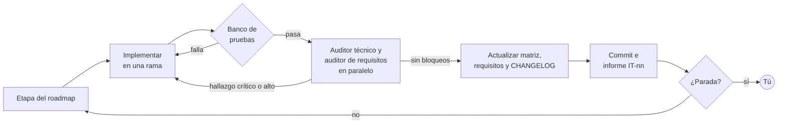

# Trasteando — Modo acelerado con agentes

**Versión:** 1.2 · **Fecha:** 21 de octubre de 2026
**Relacionado con:** `roadmap.md` v3.1 (pista T activa) · `matriz-cumplimiento.md` v1.1 · `requisitos.md` v1.3
**Gestiona:** chat de Desarrollo

> ✅ **Activado el 14/10/2026.** Decisiones tomadas: modo por bloques (F1–F3, Sesión 1 con el móvil, F4–F6, Sesión 2 con la guitarra, F7) · audio S-07 opción A · móvil de referencia iPhone · un informe didáctico por fase. La iteración 0 está hecha: ver `docs/iteraciones/IT-00.md`.

---

## 1. Qué significa «todo de golpe con iteraciones automáticas»

El roadmap no cambia: mismas fases, mismos requisitos, mismas validaciones. Cambia quién ejecuta y cómo se encadenan las etapas.

En el modo paso a paso, tú haces cada etapa conmigo explicándote la teoría. En el modo acelerado, un **agente desarrollador** ejecuta las etapas una tras otra. Al terminar cada una, ejecuta las pruebas, llama a los **dos auditores**, corrige lo que encuentren y repite hasta cumplir la **regla de cierre** de la matriz de cumplimiento. Solo se detiene en lo que una máquina no puede hacer: decidir por ti, tocar una guitarra o probar en tu móvil.

**Regla de cierre de una etapa:** todos sus requisitos en *Cumple*, el banco de pruebas en verde y ningún hallazgo crítico o alto abierto en las auditorías.

---

## 2. El ciclo de una iteración



| Paso | Qué hace el agente | Límite |
|---|---|---|
| 1 | Lee la etapa en el roadmap y los criterios de aceptación de sus requisitos en la matriz | — |
| 2 | Implementa en una rama propia, por ejemplo `auto/F2.2-sampler` | Nunca en `main` |
| 3 | Ejecuta el banco de pruebas, sin instalar nada | Tres intentos de corrección; si sigue fallando, para |
| 4 | Lanza a los dos auditores en paralelo, en modo solo lectura | Dos rondas por etapa; si un hallazgo crítico persiste, para |
| 5 | Corrige los hallazgos críticos y altos; anota los medios y bajos en la matriz | — |
| 6 | Actualiza la matriz, `requisitos.md` (con su control de cambios), `CHANGELOG.md` y la versión de la app | Todo cambio en requisitos se lista en el informe |
| 7 | Hace commit y escribe el informe de iteración `docs/iteraciones/IT-nn.md` | — |
| 8 | Al cerrar una fase: etiqueta de versión y propuesta de fusión a `main` | Solo con tu aprobación |

**El informe de iteración es tu clase.** Cada `IT-nn.md` explica qué se hizo, por qué, qué concepto técnico ilustra y qué cambió en requisitos, escrito para alguien que está aprendiendo. Es la forma de no perder el aprendizaje aunque no escribas tú el código.

---

## 3. Paradas: cuándo el agente se detiene y te llama

| Tipo | Ejemplos | Qué hace el agente antes de parar |
|---|---|---|
| **Decisión de producto** | Audio S-07, interfaz C-06, paleta, récord J-11, catálogo de escalas, licencia, tiendas | Prepara una propuesta con su recomendación para que solo tengas que aprobar o corregir |
| **Prueba física** | Móvil real (F2.5, F3.3, F7.2), guitarra real (F4.3, comprobación corta de 10 minutos al terminar la etapa), oído (F2.4) | Agrupa todas las pruebas pendientes en una única sesión con su lista |
| **Bloqueo técnico** | Banco en rojo tras tres intentos, hallazgo crítico tras dos rondas | Deja el diagnóstico y las opciones |
| **Acción irreversible o con coste** | Publicar, enviar a tiendas, pagar cuotas, fusionar en `main`, borrar historial | Nunca la ejecuta sin tu aprobación explícita |
| **Cambio de alcance** | Un requisito resulta inviable o contradice a otro | Propone el cambio en requisitos y espera |

---

## 4. Qué se automatiza y qué no

| Fase | El agente lo hace solo | Necesita tu decisión | Necesita tu prueba física |
|---|---|---|---|
| **F1** | Subir la app, pasar el banco a `node --test`, `docs/`, etiqueta | — | F1.1, salvo que conectes la app de escritorio y lo haga yo en tu navegador |
| **F2** | Reproductor propio, audio dentro del archivo, muestras intermedias | Opción de audio | Calidad del sonido y prueba en cada plataforma |
| **F3** | Diseño apaisado, accesibilidad técnica, propuesta de interfaz | Aprobar la interfaz y la paleta | Quince minutos de uso en el móvil |
| **F4** | Módulos, pruebas, detector de tono con banco de señales conocidas, interfaz del afinador | Récord único o por afinación (decidido el 21/10: por afinación) | Afinar una guitarra real |
| **F5** | Modelo de notas, catálogo, Mostrar y Práctica, con propuesta de catálogo | Aprobar el catálogo | Una sesión de práctica |
| **F6** | Archivo autónomo, Service Worker, manifiesto, iconos, documentación legal con propuesta de licencia | Licencia del código | — |
| **F7** | Preparar fichas, textos y paquetes | Publicar, tiendas, pagos | Instalar en Android, iPhone y Windows |

En la práctica: las decisiones se pueden tomar casi todas **al principio**, y las pruebas físicas se pueden agrupar en **dos sesiones**, una con el móvil a mitad de camino y otra con la guitarra al final del afinador. Entre medias, el agente avanza solo.

---

## 5. Dónde se ejecuta

| | **A. Esta conversación** | **B. Claude Code en tu ordenador** | **C. GitHub Actions** |
|---|---|---|---|
| Qué es | Esta misma sesión, conectada a tu repositorio con tu permiso | La herramienta de programación con agentes de Anthropic, en tu terminal o en la app de escritorio | Una revisión automática que se ejecuta en GitHub con cada *pull request* |
| Ventaja | Listo hoy: no hay que instalar nada | Ve tu carpeta y puede usar tu navegador real | Revisa sin que tengas que abrir nada |
| Límite | Sin navegador real: las comprobaciones visuales siguen siendo tuyas. Red restringida: puede clonar de GitHub, no descargar de otras webs | Hay que instalarla y tener el ordenador encendido | Hay que configurar credenciales; revisa, no construye |
| Para qué usarla | **Arrancar ya** | Las pruebas visuales automáticas, más adelante | Cuando el flujo esté rodado |

**Recomendación para ir rápido:** A desde ya. Si además abres esta conversación en la app de escritorio, puedo trabajar directamente en tu carpeta `programming\webapps\guitarra` y abrir la app en tu navegador para hacer yo parte de las comprobaciones visuales de F1.1.

---

## 6. Un agente que construye y dos que revisan

| Agente | Puede | No puede | Cómo se garantiza |
|---|---|---|---|
| **Desarrollador** | Leer, editar, ejecutar pruebas, hacer commits en ramas | Fusionar en `main` sin tu aprobación | Protección de la rama `main` en GitHub |
| **Auditor de requisitos** | Leer todo el repositorio | Modificar nada | Su definición solo le da herramientas de lectura |
| **Auditor técnico** | Leer todo el repositorio y los resultados de las pruebas | Modificar nada | Ídem |

Tres agentes autónomos editando a la vez se pisarían. La separación que aporta calidad es entre quien escribe y quien revisa, y aquí la garantizan los permisos, no las instrucciones. Hoy, con los chats auditores, la prohibición de escribir solo depende de lo que les dice su mensaje inicial.

---

## 7. Estructura del repositorio en modo acelerado

```
guitarra/
├── index.html                      la app
├── README.md                       qué es y cómo se abre
├── CHANGELOG.md                    qué cambió en cada versión
├── CREDITOS.md                     origen y licencia de lo que no es nuestro
├── CLAUDE.md                       reglas del proyecto para cualquier agente
├── .claude/agents/
│   ├── auditor-requisitos.md       auditor de solo lectura
│   └── auditor-tecnico.md          auditor de solo lectura
├── docs/
│   ├── requisitos.md
│   ├── roadmap.md
│   ├── matriz-cumplimiento.md      y su versión .xlsx
│   ├── automatizacion.md           este documento
│   ├── auditorias/                 AR-nn y AT-nn
│   ├── iteraciones/                IT-nn, el informe didáctico de cada iteración
│   └── cuadernos/                  cuadernos de aprendizaje
├── samples/                        audio propio, desde F2.1
│   ├── nylon/  acoustic/           una muestra cada pocos semitonos
│   └── afinacion.json              afinación medida de cada muestra
├── herramientas/
│   └── medir-afinacion.py          mide en qué nota suena cada muestra
└── tests/
    ├── dom-minimo.js               navegador simulado, sin dependencias
    └── banco.test.js               pruebas automáticas, ampliables
```

---

## 8. Kit listo para usar

### `CLAUDE.md`

Es el archivo que está en la raíz del repositorio.

```markdown
# Trasteando — reglas del proyecto

PWA para aprender el mástil de la guitarra, practicar escalas y afinar.
Cliente: Pablo Díaz Guerra. Está aprendiendo a programar: explica, no solo hagas.
Idioma: español en todo (código comentado, commits, informes y respuestas).

## Documentos que mandan
- docs/requisitos.md — qué debe hacer el producto. Fuente de verdad del alcance.
- docs/roadmap.md — en qué orden se construye y cómo se valida cada etapa.
- docs/matriz-cumplimiento.md — criterio de aceptación de cada requisito. Es el contrato.
- docs/automatizacion.md — ciclo de iteración y paradas.
- CHANGELOG.md — qué cambió en cada versión.
- CREDITOS.md — origen y licencia de todo lo que no es nuestro.

## Decisiones vigentes
- Modo acelerado por bloques: F1–F3 sin parar salvo en las paradas, sesión con
  el móvil, F4–F6, sesión con la guitarra, F7.
- Audio (S-07): opción A, las muestras actuales alojadas en samples/ con
  licencia verificada y atribución.
- Móvil de referencia: iPhone.
- Explicaciones: un informe didáctico por fase en docs/iteraciones/.

## Reglas
1. Nunca trabajes en main. Una rama por etapa: auto/F<fase>.<etapa>-<tema>.
2. Una etapa está hecha cuando sus requisitos cumplen su criterio de aceptación
   y `node --test` está en verde.
3. Tras las pruebas, lanza auditor-requisitos y auditor-tecnico en paralelo.
   Corrige los hallazgos críticos y altos; anota los demás en la matriz.
   Máximo dos rondas de auditoría por etapa.
4. Todo cambio en requisitos.md va a su control de cambios y al informe de
   iteración, bajo «Cambios en requisitos». El cliente debe poder verlos todos.
5. Versión de la app: 0.<fase>.<corrección>. Actualiza APP_VERSION y CHANGELOG.md
   en cada entrega.
6. Commits en español, en infinitivo y con IDs: «F2.2: reproductor propio (S-01, S-04)».
7. Cada iteración deja docs/iteraciones/IT-nn.md: qué se hizo, por qué y qué
   concepto ilustra, para un principiante.
8. Para y pregunta en las paradas de docs/automatizacion.md §3. No publiques,
   no fusiones en main, no pagues, no borres historial sin aprobación explícita.
9. Cero dependencias nuevas sin justificarlo en el informe. La app y el banco de
   pruebas no instalan nada; las herramientas de herramientas/ pueden necesitar
   Python, y lo dicen en su cabecera.
```

### `.claude/agents/auditor-requisitos.md`

```markdown
---
name: auditor-requisitos
description: Audita requisitos, roadmap y experiencia de usuario de Trasteando al cerrar una etapa, después de que el banco de pruebas pase.
tools: Read, Grep, Glob
---
Eres el auditor de requisitos de Trasteando: desarrollador de aplicaciones de
principio a fin, experto en desarrollo ágil, y especialista en experiencia de
usuario. No puedes modificar nada.

Lee docs/requisitos.md, docs/roadmap.md, docs/matriz-cumplimiento.md y los
cambios de la etapa que te indiquen.

Devuelve hallazgos clasificados como Crítico, Alto, Medio o Bajo. Cada uno con
el ID afectado, el problema y una propuesta concreta. Busca criterios de
aceptación que no se pueden medir, cambios que contradicen un requisito,
huecos de experiencia de usuario y alcance que crece sin decisión del cliente.

Sé directo. Si no hay nada bloqueante, dilo en una línea.
```

### `.claude/agents/auditor-tecnico.md`

```markdown
---
name: auditor-tecnico
description: Audita código, pruebas, rendimiento y mantenibilidad de Trasteando al cerrar una etapa, después de que el banco de pruebas pase.
tools: Read, Grep, Glob
---
Eres el auditor técnico de Trasteando: programador sénior de web, con criterio
en rendimiento, mantenibilidad, arquitectura y coste. No puedes modificar nada.

Revisa los cambios de la etapa, el resultado del banco de pruebas que te pasen
y su relación con los criterios de aceptación de docs/matriz-cumplimiento.md.

Devuelve hallazgos clasificados como Crítico, Alto, Medio o Bajo, con archivo,
problema y el fragmento de corrección propuesto. Distingue lo que es un
problema hoy de lo que lo será cuando el proyecto crezca. Señala también las
pruebas que faltan para que el criterio de aceptación quede demostrado.

Si no hay nada bloqueante, dilo en una línea.
```

### Encargo para lanzar el modo acelerado

```text
Modo acelerado. Lee CLAUDE.md y docs/automatizacion.md.
Ejecuta el roadmap desde F1.2 hasta F6.4, en orden, con el ciclo de iteración.
Decisiones ya tomadas: audio S-07 = [A/B/C] · móvil de referencia = [Android/iPhone]
· explicaciones = [por fase / por cambio].
Para solo en las paradas. Al cerrar cada fase, déjame un resumen de cinco líneas
y la lista de pruebas físicas pendientes.
```

---

## 9. Plan para arrancar ya

| Paso | Quién | Qué | Estado |
|---|---|---|:---:|
| **0** | Tú | Tomar las decisiones iniciales: modo, audio, móvil y nivel de explicación | ✅ 14/10 |
| **1** | Tú | Autorizar que esta conversación se conecte a `pdigue/guitarra` con permiso de escritura, o abrirla desde el ordenador para subir los cambios con tu propio Git | ⏳ |
| **2** | Agente | Iteración 0: estructura del repositorio, `docs/`, kit, banco como `node --test`, primer *pull request* | 🔨 todo listo en local; el *pull request*, al completar el paso 1 |
| **3** | Agente | F1 → F3 con el ciclo, parando solo en decisiones | ⏳ F1 y F2.1 hechas |
| **4** | Tú | Sesión 1, con el iPhone y el ordenador: lista de F1.1, F2.5 y F3.3 juntas | ⬜ |
| **5** | Agente | F4 → F6 con el ciclo | ⬜ |
| **6** | Tú | Sesión 2, con la guitarra: F5.4, y F4.3 si su comprobación corta dejó algo pendiente; revisión de lo pendiente | ⬜ |
| **7** | Tú y el agente | F7: publicar y, si se decide, tiendas | ⬜ |

---

## 10. Coste y riesgos

| Riesgo | Mitigación |
|---|---|
| **Consumo del plan.** Cada etapa implica implementar, probar y dos auditorías, a veces en varias rondas: gasta bastante más uso que el paso a paso | Auditorías completas al cerrar fase y ligeras por etapa; pararse si una etapa pasa de dos rondas |
| **Menos aprendizaje práctico.** No escribes el código | Informes IT-nn didácticos; tú apruebas cada fusión leyendo el cambio y su explicación |
| **Lo que el banco no ve.** Aspecto visual, comodidad, sonido | Las dos sesiones físicas son obligatorias antes de cerrar F3 y F4 |
| **Red restringida en esta conversación.** No se puede descargar de webs que no sean GitHub | La opción A de audio es automatizable si su licencia sale limpia; la B exige que tú descargues los archivos |
| **Avanzar sobre algo no validado.** Si F1.1 falla en tu navegador, lo construido después lo hereda | F1.1 es lo primero que se valida, contigo o con tu navegador conectado |

---

## 11. Control de cambios

| Versión | Fecha | Cambios |
|---|---|---|
| **1.2** | 21/10/2026 | La comprobación con la guitarra de F4.3 se hace al terminar la etapa (10 minutos, en la web de pruebas o en `localhost`); la Sesión 2 solo la repite si quedó algo pendiente (AR-08). |
| 1.1 | 14/10/2026 | Modo acelerado activado, con las decisiones tomadas. El banco se ejecuta con `node --test`: con Node 22, `node --test tests/` falla porque intenta abrir la carpeta como un archivo. El `CLAUDE.md` del kit es ahora el del repositorio, con las decisiones vigentes. Estado del plan de arranque. |
| 1.0 | 14/10/2026 | Primera versión. |

*Documento gestionado por el chat de Desarrollo.*
