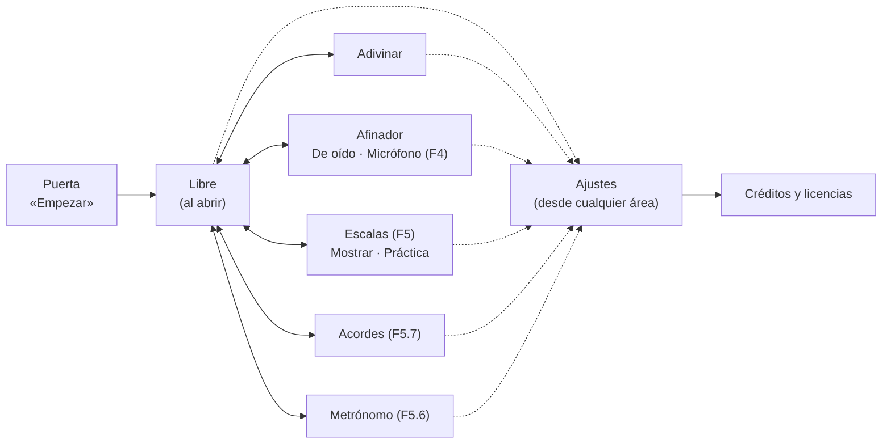

# Trasteando — Especificación de interfaz

**Versión:** 1.12 · **Fecha:** 21 de octubre de 2026 · **Estado:** ✅ aprobada por ti el 20/10/2026 (versión 1.0); la sección 7b (seis áreas, con Metrónomo y Acordes), aprobada el 21/10. Las versiones 1.1 y 1.2 corrigen cifras medidas al construirla y anotan detalles de F3.2; la 1.3 recoge la paleta que decidiste para F3.4, y la 1.4, tu comentario sobre el zoom (ver el control de cambios).
**Etapa:** F3.1 · **Requisito:** C-06 · **Válido para:** app `0.5.5` · `requisitos.md` v1.22 · `roadmap.md` v3.20
**Revisión:** auditoría de requisitos AR-04 (`auditorias/AR-04-interfaz.md`), con sus 10 hallazgos resueltos en esta versión.
**Bloquea:** F3.2 (horizontal), F3.4 (accesibilidad) y toda F5 (Escalas); fija también el hueco del micrófono de F4.

Este documento dice **qué hay en cada pantalla, dónde está y cómo se pasa de una a otra**. Desde su aprobación manda sobre el diseño de F3 a F5: lo que se construya después se compara con él. Cambiarlo es posible, sobre todo tras usarlo en la Sesión 1 (F3.3): cada cambio sube la versión y queda en el control de cambios.

## 1. Cómo leer los bocetos

Los bocetos (*wireframes*) son de **baja fidelidad**: grises y un único color de acento. Sirven para decidir la colocación, no el aspecto: la paleta definitiva se decide en F3.4 (sección 10). A cambio, **cada marco tiene el tamaño real de la pantalla en píxeles CSS**, así que las medidas que se leen en ellos son las que tendrá la app.

| Imagen | Qué muestra |
|---|---|
| [`interfaz/vertical-1.png`](interfaz/vertical-1.png) | Móvil en vertical: Libre, Adivinar y Ajustes |
| [`interfaz/vertical-2.png`](interfaz/vertical-2.png) | Móvil en vertical: Afinador (de oído y por micrófono) y Escalas (Mostrar y Práctica) |
| [`interfaz/horizontal.png`](interfaz/horizontal.png) | Móvil en horizontal: Libre, Adivinar (iPhone y Android), Escalas y Afinador |
| [`interfaz/escritorio.png`](interfaz/escritorio.png) | Ordenador: Libre con el foco de teclado |

La fuente es [`interfaz/wireframes.html`](interfaz/wireframes.html). La herramienta `herramientas/capturar-wireframes.js` genera las imágenes y **comprueba** tres cosas, midiendo el dibujo ya pintado en Chromium: que en horizontal cada cuerda mide al menos 40 px, que nada se sale de su pantalla y que todo control táctil, incluidas las casillas del mástil, mide al menos 40 × 40 px. Hoy da «Todo correcto».

> **Concepto: arquitectura de información.** Antes de decidir colores o botones se decide qué existe, cómo se agrupa y cuánto cuesta llegar a cada cosa. Si eso está bien, el resto se puede cambiar sin rehacer la app.

## 2. Principios

1. **El mástil manda.** Es lo que se usa cada segundo, así que se lleva el espacio que sobra en cada pantalla y nunca lo tapa nada.
2. **Lo frecuente, a un toque; lo raro, en Ajustes.** Tres niveles de controles (sección 5).
3. **Misma estructura en todas las áreas.** Al cambiar de área nada salta de sitio.
4. **Igual en todos los sistemas** (PL-04). Solo estándares web. La forma cambia según el tamaño de la pantalla y el tipo de puntero, nunca según el sistema.
5. **El color nunca va solo.** Todo acierto, error o estado lleva también un símbolo o un texto (✓, ✗, «Sube un poco»).

## 3. Tamaños de pantalla

La app elige su disposición por el tamaño de la ventana, no por el aparato. «Pantalla táctil» significa aquí que el puntero principal es un dedo (`pointer: coarse`), no que el aparato sea un móvil.

| Disposición | Cuándo | Navegación | Controles del área | Ajustes | Medido en |
|---|---|---|---|---|---|
| **Vertical** | Ancho < 600 px y en vertical | Barra de pestañas abajo | Arriba, sobre el mástil | Hoja que sube desde abajo | iPhone en Safari: 390 × 664 |
| **Horizontal** | Alto ≤ 520 px y en horizontal | Raíl a la izquierda | Panel a la derecha | Panel lateral | iPhone en Safari: 750 × 342 · Android de 360 dp en Chrome: 780 × 280 |
| **Amplia** | El resto | Pestañas en la cabecera | Arriba, sobre el mástil | Panel lateral | Ventana de Windows de 1280 × 720 |

Una tableta en vertical usa la disposición amplia: tiene sitio de sobra.

## 4. Mapa de la app

- **Puerta.** Se queda: en el iPhone el sonido solo puede arrancar con un toque, y es donde aparece el nombre (G-01).
- **Cuatro áreas** (G-02), siempre a un toque; **seis** cuando lleguen Acordes y Metrónomo (sección 7b, propuesta). Al abrir la app se entra siempre en Libre (L-01).
- **Afinador y Escalas tienen dos modos dentro**, con un selector arriba. No son pestañas nuevas: cada destino es una idea distinta.
- **Ajustes** se abre desde todas las áreas (C-01) y no cambia de área al cerrarse.

### Navegación y botón «atrás»

Cada área tiene su dirección: `#libre`, `#adivinar`, `#afinador`, `#escalas`. **Mientras haya un paso anterior en la sesión**, el botón o gesto «atrás» del sistema (Android, ratón o teclado en Windows) cierra Ajustes si está abierto y, si no, vuelve al área anterior. Desde la primera área visitada, «atrás» hace lo que el sistema haga normalmente: la app no lo bloquea, porque eso es una mala práctica. La Puerta no cuenta como paso. Al abrir o recargar la app se entra en Libre, aunque la dirección diga otra área (L-01). En el iPhone instalado no hay botón atrás y no cambia nada. Es una capacidad estándar (`history`), sin alternativa necesaria.

> **Concepto: el historial del navegador.** Una web de una sola página puede apuntar «pasos» en el historial sin cargar nada. Así el botón atrás se comporta como espera el usuario.

## 5. Jerarquía de controles

| Nivel | Qué entra | Dónde está | Requisitos |
|---|---|---|---|
| **1 · En pantalla** | Lo que se usa cada pocos segundos: mástil, repetir sonido, pistas, zoom, cuerdas del afinador, paso a paso de Escalas | Junto a lo que controla | D-05, J-04…J-06, V-04, A-01, E-06 |
| **2 · Acceso rápido** | Lo que se cambia a menudo sin salir del ejercicio: nomenclatura y pentagrama | Botones redondeados (*chips*): bajo la cabecera, o en el panel en horizontal | C-03, N-03, P-02 |
| **3 · Ajustes** | Lo que se elige una vez: todo lo de C-02, más créditos y versión | Hoja o panel de Ajustes | C-02, G-06, G-10 |

Un ajuste puede estar en dos niveles (la nomenclatura está en el 2 y en el 3); los dos controles se mueven juntos. El acceso rápido está en **todas** las áreas que tienen mástil y en **todas** las disposiciones.

## 6. Pantalla a pantalla (móvil en vertical)

### Libre — boceto A1

De arriba abajo: cabecera (nombre y ⚙), acceso rápido (**Do Re Mi**, **Pentagrama**), pentagrama con la nota leída a la derecha («Sol», «Sol3 · 196 Hz»), el aviso para girar (sección 7), el mástil y el zoom. La nota pulsada se rellena en color de acento; las otras posiciones de la misma nota (L-03) van solo con borde. El mástil ocupa el alto que sobra: cada cuerda mide entre 40 y 52 px en pantallas de 660 px de alto o más (§7).

### Adivinar — boceto A2

Igual que Libre, con la **tarjeta del reto** entre el acceso rápido y el mástil:

- **Primera fila:** ▶ empezar y repetir el sonido · mensaje del reto («Escucha y busca la nota», «✓ Sol3», «✗ Era Sol3 · racha a 0») · racha y récord (J-07, J-08). **Desde la 0.3.3** (Sesión 1), al entrar no suena nada: ▶ aparece resaltado y el mensaje dice «Pulsa ▶ para oír la nota»; antes de ▶ el mástil suena pero no puntúa (J-01).
- **Segunda fila (cambio):** las **pistas** (Nombre, Cuerda) y su resultado («3ª, 4ª, 5ª o 6ª»). Hoy están en la barra de acceso rápido, que en el iPhone no cabe por 4 px; dentro de la tarjeta quedan junto al reto al que ayudan (J-06).
- **Desde la 0.4.1** (tu comentario del 21/10): encendida, cada pista enseña su respuesta **dentro de su botón, en grande**, con etiqueta pequeña y borde discontinuo de «pista»: «NOTA Sol#3», «CUERDAS 3ª 4ª». Con alguna encendida, sobra el rótulo «Pistas» y las dos caben en una fila. La **lectura grande** de debajo vuelve a ser la nota que tocas: lo que buscas está en las pistas, lo que tocas en la lectura, y no se confunden.
- **Al fallar** (J-09, J-10): la posición pulsada se rellena en rojo con ✗ y, 1,2 s después, las correctas en verde con su nombre y ✓; el reto siguiente llega 3 s más tarde. **Al acertar**, todas las correctas en verde (J-03).
- La lectura grande y el pentagrama muestran **la nota que tocas** (desde la 0.4.1; en la 0.3.3 mostraban la buscada y confundían). La buscada solo se ve con la pista de nombre, en su botón, o al responder. El pentagrama no muestra la nota hasta que respondes, y «Ver todas las notas» no se aplica (J-12).

### Afinador — bocetos A3 y A4

Selector arriba: **De oído | Micrófono**. Debajo, en los dos modos, la **afinación activa** (A-06, A-07), porque el micrófono también la necesita para saber qué nota corresponde a cada cuerda.

- **De oído** (A-01, lo que hay hoy): una fila por cuerda, que suena al pulsarla y tiene − y + para bajarla o subirla un semitono (cualquier cambio la convierte en «Personalizada», A-08), y la afinación en el pentagrama (P-04, A-09).
- **Micrófono** (F4, A-02…A-05): selector de cuerda **Auto | 6 … 1** (Auto detecta la cuerda según la afinación activa, A-04; elegir una manda sobre la detección, A-05); un indicador de aguja de −50 a +50 cents con la franja de afinado de ±5 en verde (A-03); la nota grande y los cents en número; la orden en texto y flecha, **«▲ Sube un poco» / «▼ Baja un poco» / «✓ Afinada»**; un aviso fijo, «El sonido se analiza solo en tu dispositivo» (G-11), y un botón para detener el micrófono.
- **Flujo del permiso:** la primera vez, una frase explica para qué se usa el micrófono **antes** de que el navegador lo pida. Si lo deniegas, se dice cómo activarlo en ese navegador. El micrófono se apaga al salir del Afinador.
- **Si no hay micrófono** (archivo abierto con doble clic, navegador sin permiso o sin la capacidad): el modo Micrófono se muestra desactivado con el motivo, y De oído sigue funcionando (PL-04).
- **Así quedó en la 0.4.0** (diferencias con lo de arriba, revisadas en AR-08):
  - **Órdenes:** cinco, no tres. «▲ Sube» o «▼ Baja» a más de 50 cents; «▲ Sube un poco» o «▼ Baja un poco» entre 6 y 50; «✓ Afinada» a ±5. Una vez afinada, hace falta pasar de ±7 para dejar de estarlo, para que el aviso no parpadee.
  - **Sin micrófono posible**, el selector deja entrar en «Micrófono»; lo que se desactiva es el botón «Activar el micrófono», con el motivo en rojo encima.
  - **La explicación** sale siempre que el micrófono está apagado, no solo la primera vez: el micrófono nunca se enciende sin que lo pidas, ni al volver a la app.
  - Se apaga también **al ocultar la app** o bloquear el móvil, y si el sistema lo corta lo dice.
  - El modo elegido (De oído o Micrófono) **se guarda**; elegir «Micrófono» no lo enciende.
  - El aviso de privacidad, con la aguja, dice: «Afinada en la franja verde (±5 cents). El sonido se analiza solo en tu dispositivo.»
  - El detalle bajo la nota añade la cuerda: «−11 cents · 5ª cuerda».
  - **En horizontal**, «Afinación» y «Cuerda» van en filas a todo el ancho encima; debajo, la aguja a la izquierda y la lectura, la orden y «Detener» a la derecha.

### Escalas — bocetos A5 y A6 (F5)

Fila superior: **Mostrar | Práctica**, tónica y tipo (E-01: mayor, menor natural y pentatónicas mayor y menor, decidido el 21/10).

- **Mostrar** (E-03, E-04, E-06): el mástil ilumina todas las notas de la escala; la tónica lleva un anillo, para que no dependa del color. El pentagrama escribe la escala y, debajo, los intervalos entre notas con las etiquetas de E-04 (T = tono, ST = semitono). Bajo el mástil, el **paso a paso**: ◀ «Paso 3 de 8 · Mi, un tono sobre Re» ▶, que resalta la nota del paso en el mástil y en el pentagrama; y debajo, el zoom de siempre.
- **Práctica** (E-05): tocas notas y la tarjeta cuenta las notas distintas encontradas («5 de 7»). Las que vas encontrando quedan en verde. Una nota ajena sale en rojo con ✗, la tarjeta dice cuál era («✗ Fa♯ no está en Do mayor») y se iluminan las posiciones correctas a la vista.
- El pentagrama está disponible aquí también (P-03). Las escalas usan la afinación estándar en la primera entrega (E-02).
- **Así quedó en la 0.5.0:** arriba, en una fila, Mostrar | Práctica, la tónica y el tipo (en horizontal, cada selector en su fila). En Mostrar, la línea de notas e intervalos va **dentro del paso a paso**, encima de «Paso 3 de 8 · Mi, un tono sobre Re», para que todo quepa en el iPhone en vertical; el paso resaltado lleva un anillo ámbar en el mástil y un fondo ámbar en el pentagrama. El guiado sube una octava desde la tónica más grave del mástil. En Práctica, la tarjeta dice el resultado de cada nota y la cuenta («3 de 7»), con un botón «Otra vez»; el pentagrama escribe solo las notas ya encontradas. Las casillas salen de la clase de altura, así que Escalas funciona también en las demás afinaciones.

### Ajustes — boceto A7

Una hoja que sube desde abajo, con los grupos de hoy (Notación, Mástil, Sonido y afinación) y uno **nuevo, «Acerca de»**: Créditos y licencias (G-06, que exige que la app muestre los créditos), Privacidad (cuando exista la política, F6.4, G-11), Restablecer y el número de versión (G-10). **Desde la 0.5.2**, Notación incluye «Notas alteradas»: cinco selectores, uno por tecla negra (Do♯ | Re♭…), y hay un grupo «Adivinar» con «Al fallar: Ver respuesta | Reintentar» (0.5.1). **Desde la 0.4.2**, el primer grupo es «Idioma · Language» (Español | English, cada uno en su lengua; G-12). **Desde la 0.3.3**, el grupo Sonido enseña el estado del sonido con un botón «Reactivar sonido», y bajo Restablecer (que conserva el récord) hay un botón «Borrar los récords de racha» (uno por afinación desde la 0.4.1). En las filas con interruptor se toca la fila entera, que mide al menos 40 px de alto. Se cierra tocando fuera, con Escape o con «atrás»; el gesto de bajar llega en F3.4. Mientras está abierto, el resto de la página no responde (es un diálogo).

## 7. Móvil en horizontal (F3.2) — bocetos B1 a B6

El objetivo de F3.2 es que **cada cuerda mida al menos 40 px** en horizontal. Hoy, con la `0.2.3`, mide **29 px** en el iPhone con Safari (750 × 342) y 37 px instalada (844 × 390), porque el mástil comparte el alto con la cabecera, el acceso rápido, el reto y el pentagrama.

La propuesta saca todo eso del alto del mástil: **raíl | mástil | panel**.

| Zona | Medida | Contenido |
|---|---|---|
| Raíl izquierdo | 64 px de ancho | Un destino por área (cuatro hoy, seis en F5) y ⚙ abajo; con seis, cada destino mide 44 px de alto |
| Mástil | Todo el alto: números de traste (18 px) y seis cuerdas | — |
| Panel derecho | 176 px de ancho | Los controles del área, de arriba abajo (tabla siguiente), y el zoom abajo |

| Área | Panel |
|---|---|
| Libre (B1) | Do Re Mi y 𝄞 (pentagrama) · pentagrama, si está activado · nota leída · zoom |
| Adivinar (B2, B6) | Do Re Mi y 𝄞 · ▶ con racha y récord · mensaje del reto · pistas Nombre y Cuerda · pentagrama, si está activado · zoom. *En la 0.3.0, Do Re Mi y 𝄞 van arriba como en Libre, para que nada cambie de sitio entre áreas (principio 3; AR-05 #4).* |
| Escalas (B3) | Mostrar \| Práctica · tónica y tipo · paso a paso ◀ ▶ · **nota del paso y su intervalo**, que se ven aunque el pentagrama esté apagado (E-04) · pentagrama, si está activado · zoom |
| Afinador (B4, B5) | Sin mástil ni panel: De oído en rejilla de 3 × 2 cuerdas con el pentagrama debajo; Micrófono con la aguja a la izquierda y cuerda, orden y botón de detener a la derecha |

En horizontal, el botón de pentagrama del panel es el símbolo 𝄞, con su nombre para lectores de pantalla, porque «Pentagrama» no cabe junto a «Do Re Mi». Si el contenido del panel no cabe en el alto, **se desplaza el panel**; el mástil nunca, y el zoom se queda fijo abajo.

**En vertical** el mástil también manda, con una regla añadida en F3.2 (AR-05 #1): **la barra de navegación nunca se sale de la pantalla**. Por eso los 40 px por cuerda en vertical se garantizan desde 660 px de alto (un iPhone de 6,1" con Safari mide 664). En pantallas más bajas, como el iPhone SE, el mástil encoge, el pentagrama se queda en 64 px y el aviso sugiere girar el móvil.

**Medido en los bocetos:**

| Pantalla | Alto útil | Cuerda | Traste |
|---|---|---|---|
| iPhone en Safari (B1 a B3) | 342 px | **52 px** | 47 px (10 trastes a la vista) |
| Android de 360 dp en Chrome con la barra visible (B6), el más bajo previsto | 280 px | **42 px** | 45 px (11 trastes a la vista) |
| iPhone con la app instalada | 390 px | 60 px (calculado) | — |

La cuerda mide (alto útil − 28 px) / 6, así que **cumple los 40 px con un alto útil de 268 px o más**. Por debajo, la cuerda baja de 40 px; ese caso se anota y se recomienda instalar la app, que gana el alto de la barra del navegador. Los 280 px de Android son una estimación: se confirman con el simulador de Chrome en F3.2 y en un Android real cuando lo haya.

**Aviso para girar** (V-01): solo en pantallas táctiles en vertical de menos de 600 px de ancho, en Libre, Adivinar y Escalas. Es una franja discreta sobre el mástil: «⟳ Gira el móvil para ver más trastes ✕». Desaparece al girar. Si la cierras con ✕, no vuelve: se guarda con los ajustes (C-05) y «Restablecer todos los ajustes» la recupera. Nunca sale en el Afinador, que funciona igual en las dos orientaciones (V-02), ni en una ventana estrecha de Windows. No se bloquea la orientación: el iPhone no lo permite.

## 7b. Metrónomo y acordes (F5.6 y F5.7) — aprobada el 21/10

Tu petición del 21/10 y tu decisión del mismo día: **el metrónomo es una función propia**, no un chip del acceso rápido. El metrónomo sigue tu guía con la app que nos enseñaste: lo más directo.

- **Seis áreas, en este orden:** Libre · Adivinar · Afinador · Escalas · Acordes · Metrónomo. Las cuatro de siempre no cambian de sitio (principio 3); las nuevas van al final.
- **Barra inferior (vertical):** seis destinos de 65 px de ancho en el iPhone, cada uno con icono y una etiqueta corta de 11 px. **Raíl (horizontal):** seis destinos de 44 px de alto y ⚙ abajo; caben en los 342 px del iPhone apaisado. **Ordenador:** seis pestañas en la cabecera.
- **Metrónomo** (MT-01 a MT-05, hecho en la 0.5.4): pantalla propia, sin mástil, como el Afinador; funciona igual en vertical y en horizontal y no pide girar el móvil.
  - **Pantalla principal**, de arriba abajo: una **barra vertical** para el tempo (arriba, más rápido; también con las flechas del teclado); el **nombre del tempo** en italiano (Lento, Andante, Allegro…); **− 80 +**; **un punto por pulso**, el primero más grande si lleva acento y relleno el que suena; abajo, el **compás** escrito como en la partitura (4 sobre 4) y «Marcar» (tocas a ritmo y lo calcula), y el botón **Empezar**. En horizontal, la barra a la izquierda, el tempo en medio y los controles a la derecha.
  - **Al tocar el compás** se abre una ventana: los doce compases en círculos (1/4, 2/4, 3/4, 4/4, 5/4, 6/4, 3/8, 5/8, 6/8, 7/8, 9/8, 12/8), las cuatro figuras (solo el pulso, dos, tres o cuatro golpes por pulso), la casilla **Acento en el primer tiempo** y «Listo». En 6/8, 9/8 y 12/8 el pulso es la negra con puntillo: dos, tres o cuatro puntos. «Atrás», Escape o tocar fuera también la cierran. En horizontal, en dos columnas.
  - **Sigue sonando al cambiar de área**, para tocar encima en Libre, Escalas o Acordes. Mientras suena, su pestaña lleva un punto que se enciende con cada pulso; para pararlo, vuelves a ella. Se para al ocultar la app y **al escuchar con el micrófono** en el Afinador, con un aviso: su clic confundiría al detector.
- **Acordes** (AC-01 a AC-06, hecho en la 0.5.5), como lo describiste el 21/10: **a un lado el listado, al otro el acorde en el mástil**.
  - **El listado:** un buscador arriba («G» deja G, Gm, G7, G/B…; también en Do Re Mi); debajo, **Populares** (C, G, D, A, E, Am, Em, Dm y F) y **Todos**, los 30 más habituales. Tocar un nombre lo elige y lo hace sonar rasgueado. Bajo el listado, el nombre del acorde, sus notas y «Tocar».
  - **El mástil:** cada nota del acorde es un círculo **del color de su dedo** —1 azul, 2 naranja, 3 rosa, 4 verde, siempre los mismos— con el número dentro; ○ y ✕ junto al nombre de cada cuerda (al aire o que no suena) y la cejilla como una barra que une sus cuerdas. Los colores son de la paleta Okabe-Ito, que se distingue también con daltonismo, y en Acordes no se ven los colores de nota. La vista se mueve sola a los trastes del acorde.
  - **En vertical** el listado va arriba (dos filas a la vista, el resto desplazando) y el mástil abajo; el pentagrama y el zoom se apartan para que las cuerdas conserven sus 40 px, y sugiere girar el móvil. **En horizontal**, el listado va en el panel de la derecha, con el pentagrama del acorde debajo. **En pantallas amplias**, todo a la vez.
  - Con otra afinación activa, avisa de que las digitaciones son para la estándar y ofrece pasar a ella.
- **Seis pestañas:** con seis, las pestañas de la cabecera entre 600 y 959 px se estrechan y se alinean a la derecha, para no pisar el nombre.
- **Con la aprobación cambian:** G-02 y C-04 (seis destinos), el mapa de la sección 4 (con `#acordes` y `#metronomo` para el botón «atrás»), el raíl de la sección 7, las pestañas de la sección 8 y el diagrama del roadmap.
- **Alternativa considerada:** Acordes como tercer modo de Escalas (Mostrar · Práctica · Acordes) y el metrónomo como chip; mantendría cuatro destinos, pero tú los pediste como funciones propias.

## 8. Ordenador — boceto C1

Las áreas pasan a la cabecera como pestañas, y desaparece la barra inferior. El mástil usa todo el ancho (V-03): 16 trastes a la vista en 1280 px, con cuerdas de 46 px. Ajustes se abre como panel lateral. Se maneja entero con teclado (sección 9).

## 9. Accesibilidad (F3.4, G-05)

- **Mástil con teclado:** el mástil es un único punto de parada del tabulador. Dentro, **← →** cambian de traste, **↑ ↓** de cuerda, **Intro** o **Espacio** tocan la nota, e **Inicio** / **Fin** van al primer y al último traste visibles. Si la posición se sale de la vista, el mástil se desplaza solo. Técnica: *roving tabindex*, con el mástil anunciado como una cuadrícula (`role="grid"`).
- **Foco visible** en todo: anillo discontinuo de 3 px, como en el boceto C1.
- **Lectores de pantalla:** cada posición se anuncia («Sol 3, cuarta cuerda, traste 5») y los resultados del reto y del afinador se leen solos (`aria-live`). Los botones que solo tienen icono (⚙, ▶, −, +, 𝄞) llevan nombre.
- **Tamaño de toque:** en pantallas táctiles, **ningún control ni casilla del mástil mide menos de 40 × 40 px**. Los bocetos lo cumplen y la herramienta lo comprueba. Para las casillas, **la vista por defecto usa trastes de 40 px o más**. Si quieres ver más, **«+» enseña más trastes** y «−» menos, y con el dedo los trastes pueden estrecharse hasta 28 px: en el iPhone con Safari, hasta 11 a la vista en vertical y 15 en horizontal. Con ratón, hasta 24, como siempre. Si el zoom guardado (V-08) pide trastes más pequeños, se muestran los que caben, y lo guardado se conserva para que al girar el móvil vuelva el zoom elegido.
- **Movimiento:** con `prefers-reduced-motion`, sin destellos ni animaciones de desplazamiento.
- **Contraste:** 4,5:1 en textos, comprobado con herramienta en F3.4.

## 10. Color y paleta (decidida el 20/10, F3.4)

Decisión del cliente: «elige tú los colores, para que las notas se distingan bien y los semitonos sean de colores derivados». La paleta parte de los tonos de su imagen inicial y la genera `herramientas/paleta.py` (detalle y medidas en `verificaciones/V-07`):

- **Las 7 naturales**, bien separadas también con daltonismo: Do melocotón, Re verde, Mi amarillo, Fa lila, Sol rosa, La rojo y Si celeste.
- **Cada sostenido**, un tono más claro de su natural: Do♯ es un Do más claro.
- **Contraste** de 5,1:1 o más, con el texto de los puntos y como texto sobre el fondo.
- La nota pulsada va **rellena**. Las demás posiciones de la misma nota y «Ver todas las notas» van **con contorno**, sin relleno. Con «Ver todas las notas», las del mismo sonido llevan además un anillo claro por fuera (L-03, AR-06).
- El nombre de la nota se escribe siempre, por el principio 5.
- El ámbar sigue siendo el color de lo activo, el verde el del acierto y el rojo el del error.

## 11. Alternativas descartadas

| Alternativa | Por qué no |
|---|---|
| **Mástil en vertical** con el móvil en vertical, como hacen algunas apps | Rompe D-02 (cuerdas con su nombre a la izquierda), invierte la lectura de la tablatura de tu imagen y obliga a mantener dos mástiles. La horizontal ya da 42 a 52 px por cuerda. |
| **En horizontal, controles en una franja sobre el mástil** (primera versión de esta propuesta) | La franja se come 44 px de alto: en el Android de 280 px la cuerda se queda en 35 px. El panel lateral cuesta ancho, que sobra, y no alto, que falta. |
| **Menú lateral** (☰) para las áreas | Esconde las áreas tras un toque más (C-04). Con cuatro o seis destinos, una barra los muestra todos. |
| **Metrónomo como chip del acceso rápido**, con un panel (propuesta de la 1.9) | Lo descartaste el 21/10: lo quieres como función propia. |
| **Pestaña propia** para el micrófono o para Práctica | Sumaría destinos para dos ideas que ya tienen su área. Dentro de su área, con un selector, se entienden mejor. |
| **Aviso para girar a pantalla completa** | V-01 pide un aviso discreto, y la app debe poder usarse en vertical. |

## 12. Qué cambia respecto a la 0.2.3 y en los requisitos

**En la app** (se construye en F3.2, F3.4, F4 y F5):

1. Horizontal: raíl, mástil a todo el alto y panel a la derecha; de 29 a 52 px por cuerda en el iPhone.
2. Adivinar: las pistas pasan a la tarjeta del reto.
3. Aviso para girar.
4. Ajustes: grupo «Acerca de» con los créditos.
5. Ordenador: pestañas en la cabecera.
6. Direcciones por área y botón «atrás».
7. Mástil manejable con teclado; controles y casillas de al menos 40 × 40 px en pantallas táctiles.
8. Huecos fijados para el micrófono (F4) y para Escalas (F5).

**En `requisitos.md`:** aplicados en la v1.11, tras tu aprobación del 20/10.

| Requisito | Cambio |
|---|---|
| **C-06** | Pasa a implementado, con este documento en su versión 1.0. |
| **V-01** | Criterio concreto del aviso: solo en pantallas táctiles en vertical (`pointer: coarse`, ancho < 600 px), en Libre, Adivinar y Escalas; nunca en el Afinador; cerrado, se guarda con los ajustes y «Restablecer» lo recupera. |
| **V-04** | Añadido: con `pointer: coarse` un traste mide al menos 40 px, y el zoom guardado se ajusta a ese límite. Nota corregida: hoy, de 3 a 24 trastes; en el iPhone en vertical quedarán como mucho 7. |
| **G-05** | Añadido al criterio de la matriz: en pantallas táctiles, todo control y toda casilla del mástil mide al menos 40 × 40 px. |
| **C-07** (nuevo, F3.2, prioridad media) | «Mientras haya un paso anterior en la sesión, el botón o gesto “atrás” del sistema cierra Ajustes o vuelve al área anterior; desde la primera área actúa el sistema. Al abrir se entra en Libre.» Se verifica a mano en Windows y en el simulador de Android de Chrome. |
| **Criterio de F3.2** (roadmap y matriz de V-01) | «En horizontal, cada cuerda mide al menos 40 px **con un alto útil de 268 px o más**», medido en el iPhone (Safari e instalada) y en el simulador de Android. |
| **Notas** de C-01, C-02, C-03 y C-04 | Solo redacción, para que describan la interfaz nueva: Ajustes como hoja o panel lateral según la disposición (C-01); «Acerca de», con créditos y privacidad, en la lista de contenidos (C-02); las pistas en la tarjeta del reto y el acceso rápido en el panel en horizontal (C-03); barra inferior, raíl o pestañas en la cabecera según la disposición (C-04). |

## 13. Aprobación

Aprobada por ti el 20/10/2026, después de la auditoría AR-04. Lo que más pesaba de la decisión:

1. **Horizontal:** raíl a la izquierda, mástil a todo el alto y los controles en un panel a la derecha. Se ven unos 10 trastes en vez de 12, a cambio de cuerdas de 52 px.
2. **Trastes de al menos 40 px en pantallas táctiles:** en el iPhone en vertical, como mucho 7 trastes a la vez. Con ratón no cambia nada.
3. **Pistas dentro de la tarjeta del reto.**
4. **Afinador y Escalas con dos modos dentro de su pestaña.**

Los detalles se revisan tras usarla en la Sesión 1 (F3.3).

## Control de cambios

| Versión | Fecha | Cambios |
|---|---|---|
| **1.12** | 21/10/2026 | Acordes, como lo describiste: listado con buscador, populares y los 30 acordes a un lado; el acorde en el mástil al otro. Disposición en vertical, horizontal y amplia. |
| 1.11 | 21/10/2026 | Sección 7b aprobada. El metrónomo, rehecho con tu guía (la app que nos enseñaste): barra vertical, nombre del tempo, un punto por pulso y una ventana con compás, figura y acento en el primer tiempo. |
| 1.10 | 21/10/2026 | Sección 7b rehecha con tu decisión del 21/10: el metrónomo es un área propia. Seis áreas, medidas de la barra y del raíl, el metrónomo sonando en otras áreas y parado con el micrófono, y los colores de dedo de Acordes. Pendiente de tu visto bueno. Mapa, raíl y alternativas al día (AR-10). |
| 1.9 | 21/10/2026 | Ajustes con «Notas alteradas» y «Al fallar»; propuesta de metrónomo (chip y panel) y de Acordes (quinta pestaña), tu petición del 21/10. |
| 1.8 | 21/10/2026 | §6 Escalas: cómo quedó en la 0.5.0 (intervalos dentro del paso a paso, Práctica con «Otra vez»). |
| 1.7 | 21/10/2026 | §6: pistas grandes dentro de sus botones y lectura grande con la nota tocada; Ajustes con el grupo de idioma (tus comentarios del 21/10). |
| 1.6 | 21/10/2026 | §6: cómo quedó el afinador por micrófono en la 0.4.0 (órdenes, sin micrófono, permiso, horizontal), tras AR-08. |
| 1.5 | 20/10/2026 | Sesión 1 (0.3.3): Adivinar empieza con ▶ y su lectura es la nota buscada; tiempos de la corrección; en Ajustes, estado del sonido, «Reactivar sonido» y «Borrar el récord de racha». |
| 1.4 | 20/10/2026 | §9: «+» enseña más trastes y «−» menos; con el dedo se pueden pedir trastes de hasta 28 px (tu comentario del 20/10). |
| 1.3 | 20/10/2026 | §10: paleta decidida en F3.4 (7 naturales bien distintas y sostenidos derivados) y puntos secundarios con contorno. |
| 1.2 | 20/10/2026 | Tras AR-05 y AT-04: en vertical, la navegación nunca se sale y los 40 px por cuerda se garantizan desde 660 px de alto (§7); en horizontal, de 10 a 12 trastes según el ancho; en el panel de Adivinar, Do Re Mi y 𝄞 arriba, como en Libre; el zoom guardado se conserva. El gesto de bajar para cerrar Ajustes pasa a F3.4. |
| 1.1 | 20/10/2026 | Medido en F3.2 (V-06): con la cejuela de 40 px, caben como mucho 7 trastes en el iPhone en vertical y 10 en horizontal (antes se estimaban 8 y 11). Solo cambian esas cifras. |
| 1.0 | 20/10/2026 | Aprobada por el cliente. Cambios aplicados en `requisitos.md` v1.11. |
| 0.2 | 20/10/2026 | Tras AR-04: horizontal rediseñado como raíl, mástil y panel (de 45 a 52 px por cuerda en el iPhone, y 42 px en un Android de 280 px de alto); acceso rápido también en horizontal; afinación visible en el modo Micrófono; zoom en Escalas; bocetos del Afinador en horizontal; controles de 40 × 40 px comprobados por la herramienta; redacción concreta de V-01, V-04, G-05 y C-07; notas de C-01 a C-04; privacidad en F6.4; intervalos con «ST». |
| 0.1 | 20/10/2026 | Propuesta inicial (F3.1), con bocetos medidos. |
