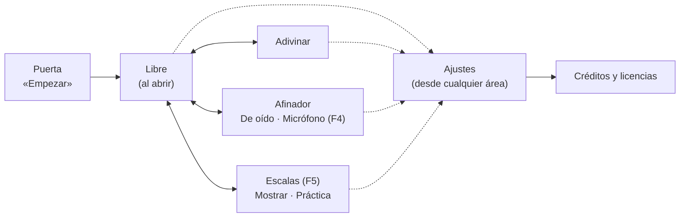

# Trasteando — Especificación de interfaz

**Versión:** 0.1, propuesta · **Fecha:** 20 de octubre de 2026 · **Estado:** ⏸️ pendiente de tu aprobación
**Etapa:** F3.1 · **Requisito:** C-06 · **Válido para:** app `0.2.3` · `requisitos.md` v1.9 · `roadmap.md` v3.7
**Bloquea:** F3.2 (horizontal), F3.4 (accesibilidad) y toda F5 (Escalas); fija también el hueco del micrófono de F4.

Este documento dice **qué hay en cada pantalla, dónde está y cómo se pasa de una a otra**. Cuando lo apruebes pasa a la versión 1.0 y manda sobre el diseño de F3 a F5: lo que se construya después se compara con él.

## 1. Cómo leer los bocetos

Los bocetos (*wireframes*) son de **baja fidelidad**: grises y un único color de acento. Sirven para decidir la colocación, no el aspecto: la paleta definitiva se decide en F3.4 (sección 10). A cambio, **cada marco tiene el tamaño real de la pantalla en píxeles CSS**, así que las medidas que se leen en ellos son las que tendrá la app.

| Imagen | Qué muestra |
|---|---|
| [`interfaz/vertical-1.png`](interfaz/vertical-1.png) | Móvil en vertical: Libre, Adivinar y Ajustes |
| [`interfaz/vertical-2.png`](interfaz/vertical-2.png) | Móvil en vertical: Afinador (de oído y por micrófono) y Escalas (Mostrar y Práctica) |
| [`interfaz/horizontal.png`](interfaz/horizontal.png) | Móvil en horizontal: Libre, Adivinar y Escalas |
| [`interfaz/escritorio.png`](interfaz/escritorio.png) | Ordenador: Libre con el foco de teclado |

La fuente es [`interfaz/wireframes.html`](interfaz/wireframes.html). La herramienta `herramientas/capturar-wireframes.js` genera las imágenes y **comprueba** dos cosas: que en horizontal cada cuerda mide al menos 40 px y que nada se sale de su pantalla. Hoy da «Todo correcto».

> **Concepto: arquitectura de información.** Antes de decidir colores o botones se decide qué existe, cómo se agrupa y cuánto cuesta llegar a cada cosa. Si eso está bien, el resto se puede cambiar sin rehacer la app.

## 2. Principios

1. **El mástil manda.** Es lo que se usa cada segundo, así que se lleva el espacio que sobra en cada pantalla y nunca lo tapa nada.
2. **Lo frecuente, a un toque; lo raro, en Ajustes.** Tres niveles de controles (sección 5).
3. **Misma estructura en todas las áreas.** Arriba lo que configura la pantalla, en medio la información, abajo el mástil y la navegación. Al cambiar de área nada salta de sitio.
4. **Igual en todos los sistemas** (PL-04). Solo estándares web. La forma cambia según el tamaño de la pantalla, nunca según el sistema.
5. **El color nunca va solo.** Todo acierto, error o estado lleva también un símbolo o un texto (✓, ✗, «Sube un poco»).

## 3. Tamaños de pantalla

La app elige su disposición por el tamaño de la ventana, no por el aparato:

| Disposición | Cuándo | Navegación | Ajustes | Ejemplo medido |
|---|---|---|---|---|
| **Vertical** | Ancho < 600 px y en vertical | Barra de pestañas abajo | Hoja que sube desde abajo | iPhone en Safari: 390 × 664 |
| **Horizontal** | Alto ≤ 520 px y en horizontal | Raíl de pestañas a la izquierda | Panel lateral | iPhone en Safari: 750 × 342 (el peor caso); instalada: 844 × 390 |
| **Amplia** | El resto | Pestañas en la cabecera | Panel lateral | Ventana de Windows de 1280 × 720 |

Una tableta en vertical usa la disposición amplia: tiene sitio de sobra.

## 4. Mapa de la app

- **Puerta.** Se queda: en el iPhone el sonido solo puede arrancar con un toque, y es donde aparece el nombre (G-01).
- **Cuatro áreas** (G-02), siempre a un toque. Al abrir, Libre (L-01).
- **Afinador y Escalas tienen dos modos dentro**, con un selector arriba. No son pestañas nuevas: así la navegación sigue teniendo cuatro destinos.
- **Ajustes** se abre desde todas las áreas (C-01) y no cambia de área al cerrarse.

### Navegación y botón «atrás»

Cada área tiene su dirección: `#libre`, `#adivinar`, `#afinador`, `#escalas`. Con eso, el botón o gesto «atrás» del sistema (Android, ratón de Windows) **cierra Ajustes si está abierto y, si no, vuelve al área anterior**, en lugar de salir de la app. En el iPhone instalado no hay botón atrás y no cambia nada. Es una capacidad estándar (`history`), sin alternativa necesaria.

> **Concepto: el historial del navegador.** Una web de una sola página puede apuntar «pasos» en el historial sin cargar nada. Así el botón atrás se comporta como espera el usuario.

## 5. Jerarquía de controles

| Nivel | Qué entra | Dónde está | Requisitos |
|---|---|---|---|
| **1 · En pantalla** | Lo que se usa cada pocos segundos: mástil, repetir sonido, pistas, zoom, cuerdas del afinador, paso a paso de Escalas | Junto a lo que controla | D-05, J-04…J-06, V-04, A-01, E-06 |
| **2 · Acceso rápido** | Lo que se cambia a menudo sin salir del ejercicio: nomenclatura y pentagrama | Botones redondeados (*chips*) bajo la cabecera | C-03, N-03, P-02 |
| **3 · Ajustes** | Lo que se elige una vez: todo lo de C-02, más créditos y versión | Hoja o panel de Ajustes | C-02, G-06, G-10 |

Un ajuste puede estar en dos niveles (la nomenclatura está en el 2 y en el 3); los dos controles se mueven juntos.

## 6. Pantalla a pantalla (móvil en vertical)

### Libre — boceto A1

De arriba abajo: cabecera (nombre y ⚙), acceso rápido (**Do Re Mi**, **Pentagrama**), pentagrama con la nota leída a la derecha («Sol», «Sol3 · 196 Hz»), el aviso para girar (sección 7), el mástil y el zoom. La nota pulsada se rellena en color de acento; las otras posiciones de la misma nota (L-03) van solo con borde. El mástil ocupa el alto que sobra: cada cuerda mide entre 40 y 52 px.

### Adivinar — boceto A2

Igual que Libre, con la **tarjeta del reto** entre el acceso rápido y el pentagrama:

- **Primera fila:** ▶ repetir el sonido · mensaje del reto («Escucha y busca la nota», «✓ Sol3», «✗ Era Sol3 · racha a 0») · racha y récord (J-07, J-08).
- **Segunda fila (cambio):** las **pistas** (Nombre, Cuerda) y su resultado («3ª, 4ª, 5ª o 6ª»). Hoy están en la barra de acceso rápido, que en el iPhone no cabe por 4 px; dentro de la tarjeta quedan junto al reto al que ayudan (J-06).
- **Al fallar** (J-09, J-10): la posición pulsada sale en rojo con ✗ y las correctas en verde con su nombre. **Al acertar**, todas las correctas en verde (J-03).
- El pentagrama no muestra la nota hasta que respondes, y «Ver todas las notas» no se aplica (J-12).

### Afinador — bocetos A3 y A4

Selector arriba: **De oído | Micrófono**.

- **De oído** (A-01, lo que hay hoy): afinación activa; una fila por cuerda, que suena al pulsarla y tiene − y + para bajarla o subirla un semitono (cualquier cambio la convierte en «Personalizada», A-08); y la afinación en el pentagrama (P-04, A-09).
- **Micrófono** (F4, A-02…A-05): selector de cuerda **Auto | 6 … 1** (Auto detecta la cuerda, A-04; elegir una manda sobre la detección, A-05); un indicador de aguja de −50 a +50 cents con la franja de afinado de ±5 en verde (A-03); la nota grande y los cents en número; la orden en texto y flecha, **«▲ Sube un poco» / «▼ Baja un poco» / «✓ Afinada»**; un aviso fijo, «El sonido se analiza solo en tu dispositivo» (G-11), y un botón para detener el micrófono.
- **Flujo del permiso:** la primera vez, una frase explica para qué se usa el micrófono **antes** de que el navegador lo pida. Si lo deniegas, se dice cómo activarlo en ese navegador. El micrófono se apaga al salir del Afinador.
- **Si no hay micrófono** (archivo abierto con doble clic, navegador sin permiso o sin la capacidad): el modo Micrófono se muestra desactivado con el motivo, y De oído sigue funcionando (PL-04).

### Escalas — bocetos A5 y A6 (F5)

Fila superior: **Mostrar | Práctica**, tónica y tipo (E-01; el catálogo se decide antes de F5.2).

- **Mostrar** (E-03, E-04, E-06): el mástil ilumina todas las notas de la escala; la tónica lleva un anillo, para que no dependa del color. El pentagrama escribe la escala y, debajo, los intervalos entre notas (T = tono, S = semitono). Abajo, el **paso a paso**: ◀ «Paso 3 de 8 · Mi, un tono sobre Re» ▶; la nota del paso se resalta en el mástil y en el pentagrama.
- **Práctica** (E-05): tocas notas y la tarjeta cuenta las notas distintas encontradas («5 de 7»). Las que vas encontrando quedan en verde. Una nota ajena sale en rojo con ✗, la tarjeta dice cuál era («✗ Fa♯ no está en Do mayor») y se iluminan las posiciones correctas a la vista.
- El pentagrama está disponible aquí también (P-03). Las escalas usan la afinación estándar en la primera entrega (E-02).

### Ajustes — boceto A7

Una hoja que sube desde abajo, con los grupos de hoy (Notación, Mástil, Sonido y afinación) y uno **nuevo, «Acerca de»**: Créditos y licencias (G-06, que exige que la app muestre los créditos), Privacidad (cuando exista la política, F7), Restablecer y el número de versión (G-10). Se cierra con el gesto de bajar, tocando fuera o con «atrás».

## 7. Móvil en horizontal (F3.2) — bocetos B1 a B3

El objetivo de F3.2 es que **cada cuerda mida al menos 40 px** en horizontal. Hoy, con la `0.2.3`, mide **29 px** en el iPhone con Safari (750 × 342) y 37 px instalada (844 × 390). La propuesta reparte la pantalla así:

| Zona | Medida | Contenido |
|---|---|---|
| Raíl izquierdo | 64 px de ancho | Las cuatro áreas y ⚙ abajo |
| Franja superior | 44 px de alto | Lo de arriba del área, en una línea: chips en Libre; ▶, mensaje, pistas, racha y zoom en Adivinar; modo, tónica, tipo y paso a paso en Escalas |
| Números de traste | 18 px | — |
| Cuerdas | El resto, en seis partes | **45 px** en Safari (750 × 342) y 53 px instalada (844 × 390) |
| Columna derecha | 132 px, **solo con el pentagrama activado** | Pentagrama y nota leída |

Medido en los bocetos: cuerda de 45 px y traste de 54 a 57 px con 9 a 12 trastes a la vista. En Adivinar en horizontal, la nomenclatura y el pentagrama se cambian desde ⚙: la franja no da para todo y el juego tiene prioridad.

**Aviso para girar** (V-01): en vertical y en pantallas de menos de 600 px, en Libre, Adivinar y Escalas aparece una franja discreta sobre el mástil: «⟳ Gira el móvil para ver más trastes ✕». Desaparece al girar o al cerrarla y, una vez cerrada, no vuelve. Nunca sale en el Afinador, que funciona igual en las dos orientaciones (V-02). No se bloquea la orientación: el iPhone no lo permite.

**Afinador en horizontal:** dos columnas, cuerdas y pentagrama a la izquierda, aguja y orden a la derecha. Sin boceto: no tiene restricciones de medida.

## 8. Ordenador — boceto C1

Las cuatro áreas pasan a la cabecera como pestañas, y desaparece la barra inferior. El mástil usa todo el ancho (V-03): 16 trastes a la vista en 1280 px, con cuerdas de 46 px. Ajustes se abre como panel lateral. Se maneja entero con teclado (sección 9).

## 9. Accesibilidad (F3.4, G-05)

- **Mástil con teclado:** el mástil es un único punto de parada del tabulador. Dentro, **← →** cambian de traste, **↑ ↓** de cuerda, **Intro** o **Espacio** tocan la nota, e **Inicio** / **Fin** van al primer y al último traste visibles. Si la posición se sale de la vista, el mástil se desplaza solo. Técnica: *roving tabindex*, con el mástil anunciado como una cuadrícula (`role="grid"`).
- **Foco visible** en todo: anillo discontinuo de 3 px, como en el boceto C1.
- **Lectores de pantalla:** cada posición se anuncia («Sol 3, cuarta cuerda, traste 5») y los resultados del reto y del afinador se leen solos (`aria-live`). Los botones que solo tienen icono (⚙, ▶, −, +) llevan nombre.
- **Tamaño de toque:** ningún control táctil por debajo de 40 × 40 px. Para cumplirlo en el mástil, **el zoom no deja que un traste mida menos de 40 px en pantallas táctiles** (cambio propuesto en V-04, sección 12).
- **Movimiento:** con `prefers-reduced-motion`, sin destellos ni animaciones de desplazamiento.
- **Contraste:** 4,5:1 en textos, comprobado con herramienta en F3.4.

## 10. Color y paleta (decisión abierta, antes de F3.4)

Los bocetos usan un único acento para no decidir la paleta. Hay dos caminos, y la estructura de esta propuesta vale para los dos:

- **Paleta actual:** un acento (ámbar) para lo activo, verde para acierto y rojo para error.
- **Color por nota**, como en tu imagen inicial: cada nota (Do, Do♯, Re…) con su color, en los puntos del mástil y en las notas del pentagrama. Encaja sobre todo con «Ver todas las notas» y con Escalas. El nombre de la nota se seguiría escribiendo siempre, por el principio 5 y por las personas que no distinguen bien los colores.

## 11. Alternativas descartadas

| Alternativa | Por qué no |
|---|---|
| **Mástil en vertical** con el móvil en vertical, como hacen algunas apps | Rompe D-02 (cuerdas con su nombre a la izquierda), invierte la lectura de la tablatura de tu imagen y obliga a mantener dos mástiles. La horizontal ya da 45 px por cuerda. |
| **Menú lateral** (☰) para las áreas | Esconde las áreas tras un toque más (C-04). Con cuatro destinos, una barra los muestra todos. |
| **Pestaña propia** para el micrófono o para Práctica | Haría seis destinos para dos ideas. Dentro de su área, con un selector, se entienden mejor. |
| **Aviso para girar a pantalla completa** | V-01 pide un aviso discreto, y la app debe poder usarse en vertical. |

## 12. Qué cambia respecto a la 0.2.3 y en los requisitos

**En la app** (se construye en F3.2, F3.4, F4 y F5):

1. Horizontal: raíl, franja superior y pentagrama opcional a la derecha; de 29 a 45 px por cuerda.
2. Adivinar: las pistas pasan a la tarjeta del reto.
3. Aviso para girar.
4. Ajustes: grupo «Acerca de» con los créditos.
5. Ordenador: pestañas en la cabecera.
6. Direcciones por área y botón «atrás».
7. Mástil manejable con teclado y zoom con trastes de al menos 40 px en pantallas táctiles.
8. Huecos fijados para el micrófono (F4) y para Escalas (F5).

**En `requisitos.md`, solo si la apruebas** (te avisaré de cada uno al aplicarlos):

| Requisito | Cambio |
|---|---|
| **C-06** | Pasa a implementado, con este documento en su versión 1.0. |
| **V-01** | Criterio concreto del aviso: dónde aparece, cómo se cierra y que nunca sale en el Afinador. |
| **V-04** | Añadido: en pantallas táctiles el zoom no deja trastes de menos de 40 px. |
| **C-07** (nuevo) | El botón o gesto «atrás» del sistema cierra Ajustes y vuelve al área anterior sin salir de la app. |

## 13. Qué necesito de ti

Que la apruebes tal cual o me digas qué cambiar. Lo que más pesa, por si quieres mirarlo primero:

1. **Horizontal** (boceto B1): raíl a la izquierda y pentagrama como columna opcional a la derecha.
2. **Pistas dentro de la tarjeta del reto** (A2).
3. **Afinador y Escalas con dos modos dentro de su pestaña** (A3 a A6), en vez de pestañas nuevas.

## Control de cambios

| Versión | Fecha | Cambios |
|---|---|---|
| **0.1** | 20/10/2026 | Propuesta inicial (F3.1), con bocetos medidos. |
