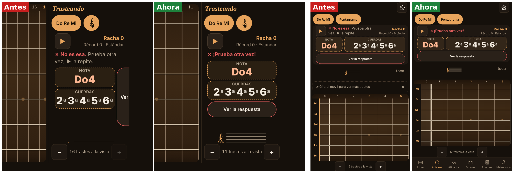

# IT-12 · F5.8 #10 · Ningún control fuera de la pantalla (`0.6.12`)

**Fecha:** 16/11/2026 · **Rama:** `auto/F5.8-respuesta` (PR #26) · **Versión:** `0.6.12` · **Requisitos:** J-14 (nuevo), J-06, V-01 y V-04 (modificados)

## Qué pasaba
Tu captura del iPhone en horizontal: tras fallar con las dos pistas, «Ver la respuesta» salía cortado a la derecha del panel. Y el mensaje de fallo era largo («No es esa. Prueba otra vez; ▶ la repite.»).

## Qué se hizo
- **«Ver la respuesta», debajo.** En horizontal las pistas van en **columna** (una encima de otra). El botón tenía `flex-basis: 100%` para ocupar «una fila entera»; pero en una columna, la base de un elemento flexible es su **alto**, no su ancho. Con saltos permitidos (`flex-wrap`), Safari entendía «este no cabe en la columna» y abría otra a la derecha, fuera del panel. Ahora, en horizontal, sin saltos y a su tamaño natural.
- **Al fallar, solo «✗ ¡Prueba otra vez!».** La ✗ queda: marca el fallo sin depender del color.
- **La revisión de todo** que pediste destapó tres fallos más, que nadie había visto:
  - en vertical, con las pistas encendidas, **las pestañas se salían por abajo** (sobraban 10 px, y 57 tras un fallo). Ahora, con pistas, el aviso para girar se esconde (vuelve al apagarlas) y las cajas miden 48 px en vez de 58;
  - el **zoom de inicio** en horizontal daba trastes de 38 px en el iPhone 15 Pro instalado, y en tu Pro Max (932 px de ancho) entraba en la regla «900 px o más = tableta»: 17 trastes de 28 px. Ahora cuenta los que caben a 40 px en el ancho real: 9 y 11. Tu zoom guardado (12) no cambia;
  - en un Android muy bajo (280 px), el botón de Ajustes del raíl quedaba cortado. Ahora el raíl se desplaza, como el panel;
  - y, tras la auditoría, en un iPad mini en horizontal con Safari el mástil se salía por abajo tras un fallo. En tableta, «Ver la respuesta» va ahora en la fila de las pistas.

## El concepto: las zonas seguras
Un iPhone con isla no es un rectángulo útil: en horizontal, la isla y la barra de inicio se comen unos 59 px a cada lado y 21 abajo. El CSS los recibe con `env(safe-area-inset-left)` y los usa como relleno. Mi comprobación medía en un rectángulo limpio de 852 × 393 y no los veía. Ahora Chromium los **simula** (`Emulation.setSafeAreaInsetsOverride`), y la herramienta mira cada botón: dentro de la pantalla, fuera de las zonas seguras y sin que lo recorte ninguna caja. La lección: una prueba solo ve lo que se le pide mirar. Antes daba por bueno todo lo que estaba dentro del panel «porque se desplaza», y precisamente ahí estaba el fallo.

## Cómo se comprobó
- **Con la 0.6.11**, la herramienta nueva dio 14 fallos, entre ellos el de tu captura. **Ahora**, 81 pantallas (iPhone, Android simulado e iPad) en español y en inglés, todo correcto.
- `comprobar-pistas.js`: 126 de 126. Banco: 234 de 234.
- Auditorías AT-22 y AR-23, sin críticos. Una recordó algo importante: las herramientas usan Chromium, no Safari; por eso tu prueba en el iPhone sigue haciendo falta.
- **Falta:** tu prueba en el iPhone (ESTADO §2, 15).
