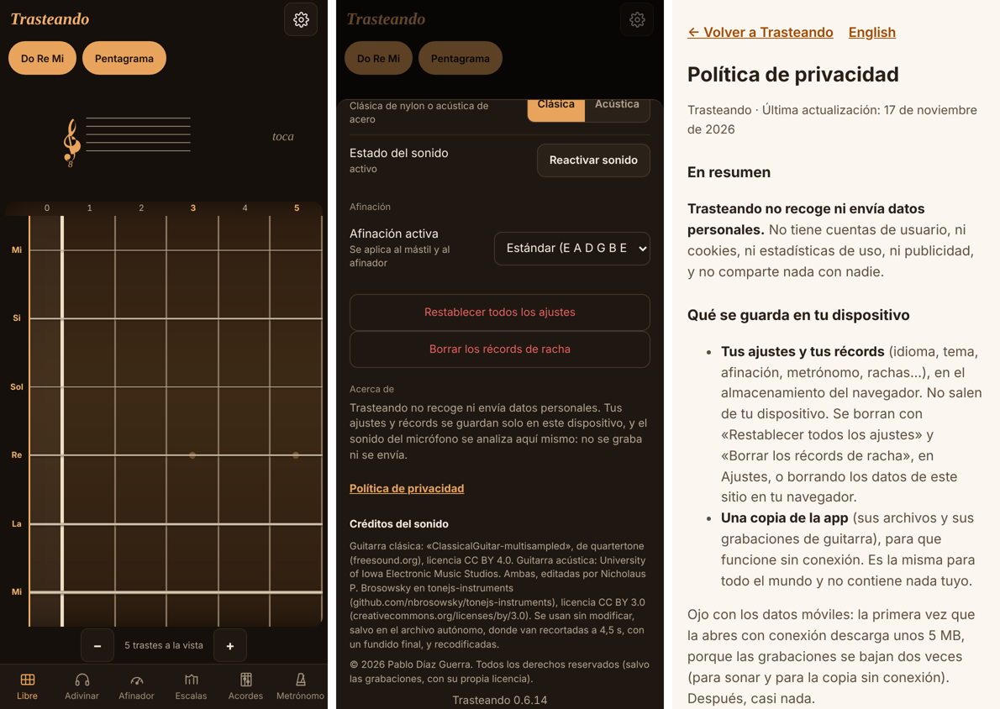

# IT-13 · F6.4 · Privacidad, licencia y créditos (`0.6.14` y `0.6.15`)

**Fecha:** 17/11/2026 · **Rama:** `auto/F6.4-privacidad` (PR #27) · **Versiones:** `0.6.14` y `0.6.15` · **Requisitos:** V-01, G-06, G-11, AC-07 y J-14 (modificados)

## Qué faltaba
Antes de publicar una app hay papeles que poner en orden: **de quién es** el código y qué se puede hacer con él (la licencia), **de quién es** lo que no hiciste tú (los créditos de las grabaciones) y **qué hace con los datos** de quien la usa (la privacidad). Las tiendas de aplicaciones, además, exigen una política de privacidad con dirección web. Y tú decidiste el 17/11 quitar el aviso para girar el móvil en todos los casos.

## Qué se hizo
- **`LICENSE`**: «todos los derechos reservados». Que el repositorio sea público (lo necesita la web de pruebas gratuita) **no** lo hace libre: sin licencia que lo permita, nadie puede copiarlo ni reutilizarlo. Las grabaciones son la excepción: no son tuyas y conservan su licencia CC BY.
- **`privacidad.html`**: una página aparte, en español y en inglés (`#en`), que no carga nada de fuera. Dice lo que la app hace de verdad: guarda ajustes y récords **en el propio navegador** (`localStorage`), analiza el micrófono **allí mismo**, la aloja GitHub y la primera visita descarga unos 5 MB.
- **Ajustes → Acerca de**: un resumen de la privacidad, el enlace a la política, los créditos del sonido y la versión. El enlace se abre **en la misma ventana**: en el iPhone, con la app instalada, otra pestaña la sacaba a Safari, donde no está el Service Worker y sin red no abre (AT-23).
- **Sin aviso para girar**: fuera del HTML, el CSS, el código y los textos. Si alguien lo había cerrado, ese ajuste guardado se descarta al abrir la app.

## El concepto: una promesa que el código vigila
Una política de privacidad es una **promesa**. El riesgo es que mañana alguien añada, por ejemplo, unas estadísticas de uso y la promesa deje de ser verdad sin que nadie se dé cuenta. Por eso el banco no se limita a comprobar que la página existe: **lee el código de la app** y falla si aparece cualquier forma de enviar datos (`sendBeacon`, `XMLHttpRequest`, `WebSocket`, cookies) o un `fetch` que no sea el de las grabaciones. Es la idea de convertir una regla escrita en una **prueba automática**: así la regla se cumple sola, cada vez que se pasa `node --test`.

Otro detalle: el **archivo autónomo** (`dist/trasteando.html`) se abre desde el disco, sin la carpeta al lado, así que un enlace a `privacidad.html` no encontraría nada. La herramienta que lo fabrica (`ensamblar.js`) cambia ese enlace por la dirección de la web. Y la prueba que vigila que la app no descargue nada de otros servidores (S-07) sigue siendo estricta: acepta esa dirección **solo** como enlace del «Acerca de», porque un enlace no descarga nada hasta que lo tocas.

## Cómo se comprobó
- Banco: **237 de 237**, con pruebas nuevas del «Acerca de» en los dos idiomas (también en el autónomo), de que sus créditos son los de `CREDITOS.md` con todo lo que pide CC BY, de la política, de `LICENSE` y de que el aviso ya no existe.
- Chromium: `comprobar-disposicion` (ninguna pantalla con aviso, ningún control fuera), `comprobar-accesibilidad` (contrastes con Ajustes abierto) y `comprobar-sin-conexion` (42 de 42 archivos guardados, la política incluida).
- Auditorías ligeras AT-23 y AR-24: sin críticos. Sus dos altos (el enlace que sacaba de la app; la atribución sin las direcciones de la licencia 4.0 y de la obra), corregidos en la `0.6.15`.

## Lo que no es
No soy abogado: la licencia y la política están escritas con sentido común y conviene que las leas. La política **aún no es pública** (lo será al publicar la app, F7.1) y no tiene contacto, por tu decisión; las tiendas probablemente lo pedirán (F7.4).
