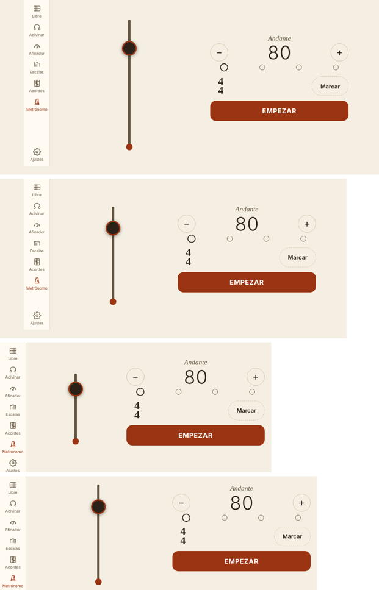

# IT-14 · F5.8 #11 · Tus decisiones del 17/11 (`0.6.16`)

**Fecha:** 17/11/2026 · **Rama:** `auto/F5.8-decisiones` · **Versión:** `0.6.16` · **Requisitos:** V-10, A-02 y MT-06 (y MT-01 y G-04)

## Qué se pidió
Al repasar los puntos abiertos decidiste tres cosas:
- **«Partitura»** pasa a ser el tema de fábrica.
- El **afinador** abre siempre en Micrófono.
- El **metrónomo en horizontal** se ordena en dos bloques, como en tus fotos: a la izquierda la barra, con el mismo giro que en vertical, y a la derecha todo lo demás.

## Qué se hizo
- **Metrónomo.** En horizontal, la pantalla es una **rejilla de dos columnas** (CSS `grid`). La de la izquierda es para la barra. La de la derecha tiene cuatro filas: dos huecos elásticos (`1fr`), uno arriba y otro abajo, y entre ellos el tempo y los controles. Así ese bloque queda centrado en el alto, sea cual sea el móvil.
  - Para que la barra se abra **30°**, su caja tiene que medir de ancho lo que mide la varilla más 44 px; si no, la pesa se sale.
  - La barra pregunta a su caja cuánto mide con una **consulta de contenedor**: `max-height: calc(100cqw - 16px)`, donde `cqw` es el 1 % del ancho de su caja. Si la columna es estrecha, la varilla se acorta en vez de abrirse menos.
  - Medido: 30° en todas las pantallas, con la barra de 195 a 342 px. Antes eran unos 13°.
- **Tema.** El valor de fábrica cambia en `02-estado.js`, y también en el propio `<html>` y en el manifiesto. Así, antes de que el código lea lo guardado, la página ya es color papel, y en Android también la pantalla de arranque.
  - `00-aspecto.js` corre antes de pintar y, si guardaste otro tema, lo aplica entero: el tema, si es claro u oscuro, y el color de la barra del sistema. Sin eso, «Automático» en oscuro salía un instante claro, y eso lo vio la auditoría.
- **Afinador.** Se quita la «memoria» (`tunerPick`). Lo que eliges vale mientras la app está abierta; al volver a abrirla, Micrófono.

## Qué concepto ilustra: el «valor de fábrica» y los datos que ya existen
Cambiar un valor por defecto parece cambiar una línea, pero hay que pensar en **quien ya usa la app**. La app guarda todo su estado en el navegador (`localStorage`), también lo que nunca tocaste. Así que quien tenía la app con Madera de fábrica y cambió cualquier ajuste tiene escrito «madera» y sigue con Madera: el código no puede saber si lo eligió o lo heredó.

Pasa lo mismo al revés con el afinador: había una marca guardada, `tunerPick`, que decía «esto lo elegiste tú». Al cambiar la regla, la versión nueva tiene que **borrar** esa marca vieja (es una «migración»). Si no, alguien seguiría abriendo en De oído por un dato de hace semanas.

La lección: cuando cambia lo de fábrica, hay que decidir qué pasa con los datos guardados (respetarlos, migrarlos o borrarlos) y dejarlo escrito. Aquí se respeta el tema, porque es una elección visible y se cambia en Ajustes, y se borra la memoria del afinador, porque lo decidiste así.

## Para probar en tu iPhone
1. **Metrónomo en horizontal.** La barra va a la izquierda y se abre como en vertical; lo demás, a la derecha.
2. **Afinador.** Elige De oído, cierra la app del todo y ábrela: tiene que salir Micrófono.
3. **Tema.** Si sigues viendo Madera, es el tema que tenías guardado: cámbialo en Ajustes › Aspecto o pulsa «Restablecer».
