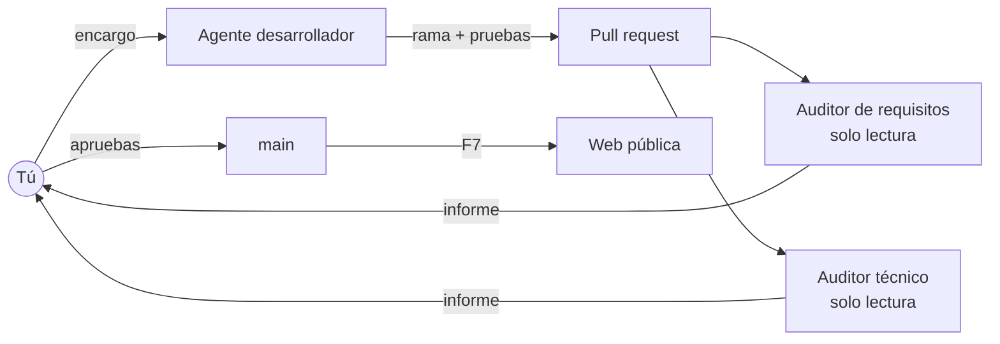
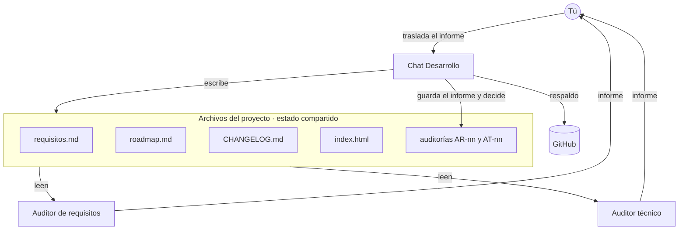

# Trasteando — Roadmap de ejecución

**Versión:** 3.2 · **Fecha:** 15 de octubre de 2026
**Válido para:** app `0.1.4` · `requisitos.md` v1.4 · `matriz-cumplimiento` v1.2 · `compatibilidad.md` v1.0 · `automatizacion.md` v1.1 · `CHANGELOG.md`
**Gestiona:** chat de Desarrollo

> ⚡ **Modo acelerado activo desde el 14/10** (detalle en `automatizacion.md`). El agente ejecuta las etapas por bloques —F1 a F3, luego F4 a F6— y solo para en las decisiones. Las pruebas que necesitan tus manos se agrupan en dos sesiones: **Sesión 1** con el iPhone y el ordenador al cerrar F3, y **Sesión 2** con la guitarra al cerrar F6.

> Este documento da el rumbo a todas las conversaciones del proyecto: qué fases hay, qué requisitos cierra cada etapa, cómo se valida, cuándo se consulta a los auditores y qué hará falta para lanzar. El paso a paso detallado de cada etapa, con su teoría, se hace en el chat de Desarrollo.

---

## 1. Estado de un vistazo

📍 **Estás aquí:** F1 y F2.1 hechas; CP-1 superado con la `0.1.4`. ⛔ **Parada:** subir el repositorio a GitHub antes de empezar F2.2, el reproductor de audio propio.

| Fase | Objetivo | Versión | Dónde se usa | Etapas | Progreso |
|------|----------|:---:|---|:---:|---|
| **F1** | Base local verificada | 0.1.x | 💻 Live Server | 4 | `▰▰▰▰▰▰▱▱` 3/4 |
| **F2** | Sonido propio y archivo autónomo | 0.2.x | 📁 Archivo en cualquier dispositivo | 5 | `▰▰▱▱▱▱▱▱` 1/5 |
| **F3** | Interfaz y adaptación | 0.3.x | 📁 Archivo | 4 | `▱▱▱▱▱▱▱▱` 0/4 |
| **F4** | Afinador por micrófono | 0.4.x | 💻 Live Server | 4 | `▱▱▱▱▱▱▱▱` 0/4 |
| **F5** | Escalas | 0.5.x | 📁 Archivo | 5 | `▱▱▱▱▱▱▱▱` 0/5 |
| **F6** | Preparación para distribución | 0.6.x | 💻 Live Server | 4 | `▱▱▱▱▱▱▱▱` 0/4 |
| **F7** | Publicación y lanzamiento | **1.0.0** | 🌐 Web y tiendas | 5 | `▱▱▱▱▱▱▱▱` 0/5 |
| **T** | Automatización con agentes *(activa)* | — | 🤖 Repositorio | 5 | `▰▰▰▰▰▱▱▱` 3/5 |

**Leyenda de estados:** ⬜ pendiente · ⏳ en curso · 🔨 hecha (sin validar) · ✅ validada · 📅 en una sesión de pruebas contigo · ⛔ descartada

---

## 2. Mapa del recorrido

```mermaid
flowchart LR
  F1["F1 · Base local<br/>0.1.x · 💻"]:::now --> CP1{{CP-1}}
  CP1 --> F2["F2 · Sonido propio<br/>0.2.x · 📁"]
  F2 --> CP2{{CP-2}} --> F3["F3 · Interfaz<br/>0.3.x · 📁"]
  F3 --> S1(["🧪 Sesión 1<br/>iPhone y ordenador"]):::you --> CP3{{CP-3}} --> F4["F4 · Micrófono<br/>0.4.x · 💻"]
  F4 --> CP4{{CP-4}} --> F5["F5 · Escalas<br/>0.5.x · 📁"]
  F5 --> CP5{{CP-5}} --> F6["F6 · Preparación<br/>0.6.x · 💻"]
  F6 --> S2(["🎸 Sesión 2<br/>con la guitarra"]):::you --> CP6{{"CP-6<br/>¿lanzamos?"}} --> F7["F7 · Publicación<br/>1.0.0 · 🌐"]
  subgraph T["Pista T · modo acelerado, activo desde el 14/10"]
    direction LR
    T1["T1 docs al repo"]:::done --> T2["T2 agente + reglas"]:::done --> T3["T3 auditores<br/>de solo lectura"]:::done --> T4["T4 ramas y<br/>pull requests"]:::now --> T5["T5 auditoría<br/>automática"]
  end
  F1 -.-> T1
  classDef now fill:#e8a45c,color:#1a1006,stroke:#c9853f,stroke-width:2px
  classDef done fill:#3f6b4f,color:#ffffff,stroke:#2e5039
  classDef you fill:#4f6fa8,color:#ffffff,stroke:#3a5689
```

*El diagrama se ve como dibujo en GitHub y en el panel visual del proyecto. En otros visores aparece como texto.*

---

## 3. Los tres modos de ejecución

Esta distinción gobierna el orden del roadmap: decide qué funcionalidad es posible en cada fase.

| Modo | Cómo se abre | Lo que permite | Lo que no permite |
|------|--------------|----------------|-------------------|
| 📁 **Archivo** (`file://`) | Doble clic sobre el `.html` | Todo lo que vaya **dentro** del propio archivo | Leer otros archivos locales (ni los de la misma carpeta), micrófono, Service Worker, instalar como app. Lo que venga de internet depende de tener conexión y de que el servidor lo permita |
| 💻 **Local** (`http://localhost`) | Live Server en el ordenador | Todo, igual que publicado | Solo existe mientras el ordenador está encendido, y solo en ese ordenador |
| 🌐 **Web** (`https://`) | Publicada en internet | Todo, desde cualquier dispositivo | — |

**Tres consecuencias:**

1. Para que la app funcione **de verdad sin conexión abriendo el archivo**, el audio tiene que ir dentro del HTML. Se resuelve en F2.
2. El **micrófono** exige contexto seguro: `localhost` o `https`. Un móvil que entra por WiFi al Live Server del ordenador (`http://192.168…`) **no** es contexto seguro, así que ahí tampoco funciona. El afinador por micrófono se usa en el ordenador durante F4 y llega al móvil en F7.
3. En **iPhone**, abrir un HTML desde la app Archivos muestra una vista previa que no ejecuta JavaScript. El modo archivo probablemente no sirva en iOS; se confirma en F2.5.

**Respaldar no es publicar.** Tener el código en GitHub es un respaldo privado de hecho: nadie lo encuentra ni lo usa como app. La app solo se vuelve pública al activar GitHub Pages, en F7.1.

---

## 4. Versiones y control de cambios

Cada pieza del proyecto lleva su propio número, y todas se citan entre sí.

| Qué | Pauta | Dónde se registra | Ejemplo |
|---|---|---|---|
| **App** | `0.‹fase›.‹corrección›`, y `1.0.0` al lanzar | `CHANGELOG.md` y en Ajustes de la app | `0.1.3` = fase F1, cuarta entrega |
| **Requisitos** | `1.x` | Sección 2 de `requisitos.md` | v1.3 |
| **Roadmap** | `x.y`: sube la x si cambian las fases, la y si se ajustan | Sección 12 de este documento | v3.1 |
| **Matriz de cumplimiento** | `1.x` | Hoja *Control de cambios* | v1.1 |
| **Cierre de fase** | Etiqueta de Git `v0.‹fase›.‹corrección›`, puesta en `main` | Repositorio | `v0.1.3` |
| **Auditorías** | `AR-nn` requisitos · `AT-nn` técnica | `docs/auditorias/` y el proyecto de Claude | AR-02, AT-02 |
| **Informes de iteración** | `IT-nn` | `docs/iteraciones/` | IT-00 |

**Trazabilidad en ambos sentidos.** Cada requisito indica su etapa y la versión en que se implementó; cada etapa de este roadmap lista los requisitos que cierra; cada entrada del `CHANGELOG.md` cita sus requisitos. La sección 18 de `requisitos.md` es la tabla completa por etapa, y la matriz de cumplimiento dice cómo se demuestra cada uno.

---

# FASES

## F1 — Base local verificada · `0.1.x` · 💻

**Objetivo:** confirmar que el núcleo funciona y recuperar el control de versiones para no volver a perder trabajo.
**Cierre de fase:** etiqueta `v0.1.x` en Git y los 59 requisitos del núcleo en ✅ validado. En modo acelerado, la validación en tu navegador (F1.1) se hace en la Sesión 1; mientras, la sostiene el banco automático.

| Etapa | Qué se hace | Requisitos | Cómo se valida | Aprenderás | Estado |
|---|---|---|---|---|:---:|
| **F1.1** | Probar la app en Live Server con la lista de abajo | G-01, G-02, N-01…N-05, D-01…D-03, D-05…D-07, S-01…S-06, P-01, P-02, P-04, L-01…L-03, J-01…J-09, A-01, A-06…A-11, V-02…V-08, C-01…C-05 | Lista de 15 comprobaciones | Herramientas del navegador (F12): consola, red, simulador de dispositivos | 📅 Sesión 1 |
| **F1.2** | Subir el repositorio a GitHub. En modo acelerado los commits los hace el agente; tú revisas y apruebas el *pull request* | X-01 | GitHub muestra la rama y el *pull request*; tú lo apruebas. **Parada antes de F2.2** (CP-1) | Repositorio, commits, ramas, *pull request*; leer un historial con `git log` | 🔨 commits listos en local · falta vincular GitHub |
| **F1.3** | Revelar la respuesta al fallar y correcciones de revisión. La `0.1.3` corrige el registro agudo de la guitarra clásica | G-10, D-04, J-10, J-12, V-09 | Banco automático (15 pruebas con `node --test`) y comprobaciones 9–12 y 15 de F1.1 | Cómo se diseña el refuerzo en una herramienta de aprendizaje | 🔨 0.1.4 |
| **F1.4** | Cierre: documentos a `docs/`, etiqueta de versión, cuadernos al día, decisión sobre la pista T | X-01 | El repositorio tiene `docs/`; `git tag` muestra `v0.1.4` | Etiquetas de Git y registro de cambios | 🔨 falta la etiqueta, que se pone en `main` al aprobar el *pull request* |

### Lista de comprobación de F1.1

| # | Comprobación | Origen |
|:---:|---|---|
| 1 | Al abrir Afinador, el mástil desaparece | AUD-01 |
| 2 | La nota suena al instante al pulsar | AUD-03 |
| 3 | 1ª cuerda, trastes 12 y 24: la nota aparece en el pentagrama, con 8va en el 24 | AUD-05 |
| 4 | Bajar la 6ª cuerda al mínimo en el afinador: la nota aparece con 8vb | AUD-05 |
| 5 | Poner Acústica, Restablecer: vuelve a sonar la clásica | AUD-08 |
| 6 | Pulsar una nota, esperar 3 s, cambiar a C D E: el nombre cambia | AUD-08 |
| 7 | Ir al traste 15 y hacer zoom: la vista sigue en el 15 | AUD-13 |
| 8 | Ventana estrecha y − hasta el tope: la etiqueta dice los trastes que caben | AUD-12 |
| 9 | 🆕 Fallar en Adivinar: se marca el fallo, se iluminan las posiciones correctas y suena la nota buscada | J-10 |
| 10 | 🆕 Con «Ver todas las notas» activo: en Libre se ven todos los nombres, en Adivinar no | J-12 |
| 11 | 🆕 Numeración en «Guía»: solo 3, 5, 7, 9, 12… | D-04, V-09 |
| 12 | Ajustes muestra «Trasteando» y la versión que estás probando | G-10 |
| 13 | El récord y los ajustes sobreviven a recargar la página | J-08, C-05 |
| 14 | Recorrido completo por las cuatro pestañas y Ajustes sin errores en la consola | General |
| 15 | 🆕 Guitarra clásica, 1ª cuerda, trastes 7, 8 y 12: suenan Si, Do y Mi igual que en tu guitarra afinada, sin saltar medio tono en el 8 | S-01, S-08 |

### 🔍 CP-1 — Checkpoint ligero tras F1

| | |
|---|---|
| **Qué se congela** | App `0.1.3`, `requisitos.md` v1.3, este roadmap v3.1, matriz v1.1 y el repositorio reorganizado |
| **Auditor de requisitos** | Coherencia entre los documentos; huecos en la sección de plataformas; si el orden local-primero perjudica algún objetivo; si agrupar las pruebas en sesiones deja algo sin validar demasiado tiempo |
| **Auditor técnico** | Revisión del cambio `0.1.1 → 0.1.3`; validez del banco de pruebas; viabilidad del audio dentro del archivo (F2.3) con los pesos medidos en F2.1 |
| **Cómo se hace** | En modo acelerado, el chat de Desarrollo lanza los dos auditores en paralelo como subagentes de solo lectura |
| **Salida** | Informes AR-02 y AT-02 en `docs/auditorias/` y en el proyecto; el chat de Desarrollo decide y actualiza |
| **Resultado (15/10)** | ✅ Superado. Un hallazgo alto técnico (carrera al cambiar de timbre) y dos bajos, corregidos en la `0.1.4` con tres pruebas nuevas. De requisitos: subir el repositorio pasa a ser parada antes de F2.2, criterios medibles para F2, dos comprobaciones cortas entre sesiones y dos decisiones nuevas |

---

## F2 — Sonido propio y archivo autónomo · `0.2.x` · 📁

**Objetivo:** que el sonido no dependa de nadie y que el archivo funcione solo, sin servidor ni conexión.
**Decisión previa:** opción de audio de S-07 → **A**, decidida el 14/10: las muestras actuales, con licencia verificada.

| Etapa | Qué se hace | Requisitos | Cómo se valida | Aprenderás | Estado |
|---|---|---|---|---|:---:|
| **F2.1** | Elegir la fuente de audio, descargarla y documentar su licencia | S-07, G-06, S-08 | `CREDITOS.md` con origen y licencia de cada archivo; cada muestra medida a ±5 cents de su nota | Qué es un CDN; licencias de contenido (dominio público, CC0, CC-BY); formato y frecuencia de muestreo; medir la afinación con el espectro | 🔨 falta confirmar la licencia del resto del pack de nylon |
| **F2.2** | Sustituir Tone.js por un reproductor de muestras propio, de unas cincuenta líneas | PL-04, S-01, S-08 | El banco recorre todas las notas del mástil en los dos timbres: muestra más transposición dan la frecuencia teórica, ±5 cents; ninguna dirección externa en el código; ninguna espera programada entre la pulsación y el sonido. Comprobación corta en el iPhone: 5 minutos de escucha comparada | Web Audio API: grafo de audio, decodificar, buffers, cambiar el tono variando la velocidad | ⬜ |
| **F2.3** | Meter el audio dentro del propio HTML | S-07, G-07 | En modo avión y con doble clic suena la guitarra real; el archivo autónomo pesa ≤ 1,5 MB y abre en ≤ 3 s en Windows. Lo genera una herramienta en `dist/`: `index.html` no lleva el audio dentro (AT-02) | Codificación base64; compromiso entre autonomía y peso | ⬜ |
| **F2.4** | Añadir muestras intermedias para el registro agudo | S-01, S-08 | En afinación estándar, la transposición máxima de nylon es ≤ 6 semitonos y la de la acústica la menor que permitan sus muestras, anotada; cada muestra nueva medida a ±5 cents | Por qué un sampler necesita varias muestras; qué degrada el sonido al transportar | ⬜ |
| **F2.5** | Probar el archivo autónomo en cada plataforma | G-07, PL-01, PL-02, PL-03 | Tabla de resultados: Windows e iPhone, el móvil de referencia; Android si hay uno a mano | Cómo abre cada sistema un archivo local, y por qué iOS es distinto | 📅 Sesión 1 |

### 🔍 CP-2 — Checkpoint del sonido

| | |
|---|---|
| **Auditor técnico** | Reproductor propio, memoria y tiempo de arranque con el audio incrustado; que no quede ninguna dependencia externa |
| **Auditor de requisitos** | Calidad del sonido frente a S-01; si el peso del archivo es aceptable; resultado de iOS y alternativas |

---

## F3 — Interfaz y adaptación · `0.3.x` · 📁

**Objetivo:** igual de cómoda en ordenador y en móvil, en las dos orientaciones.

| Etapa | Qué se hace | Requisitos | Cómo se valida | Aprenderás | Estado |
|---|---|---|---|---|:---:|
| **F3.1** | Especificar la interfaz pantalla a pantalla. **Bloquea F3.2 y toda F5**. En modo acelerado, el agente propone `interfaz.md` y **para** hasta que lo apruebes | C-06 | `interfaz.md` revisado por el auditor de requisitos y aprobado por ti | Wireframes, jerarquía visual, arquitectura de información | ⬜ |
| **F3.2** | Diseño apaisado y aviso discreto para girar el móvil | PL-04, V-01 | En horizontal, cada cuerda tiene al menos 40 px | Diseño adaptable: media queries, unidades relativas | ⬜ |
| **F3.3** | Quince minutos de uso real en el móvil, con la guitarra delante | Validación en móvil de los requisitos de F1.1 | Lista táctil y notas de lo incómodo | Eventos de puntero; latencia percibida | 📅 Sesión 1 |
| **F3.4** | Accesibilidad completa y paleta de colores | G-05 | Recorrer la app solo con teclado; contraste 4,5:1; simulador de daltonismo | ARIA, contraste, por qué el color no debe ser la única señal | ⬜ |

### 🔍 CP-3 — Checkpoint de interfaz
Peso principal en el **auditor de requisitos** como experto en experiencia de usuario: contraste con `interfaz.md`. El **técnico** revisa el diseño adaptable y el rendimiento en móviles modestos.

---

## F4 — Afinador por micrófono · `0.4.x` · 💻

**Objetivo:** cerrar el segundo gran objetivo del producto (O-04).
**Restricción:** se desarrolla y usa en el ordenador con Live Server. En el móvil llega en F7.

| Etapa | Qué se hace | Requisitos | Cómo se valida | Aprenderás | Estado |
|---|---|---|---|---|:---:|
| **F4.1** | Partir el archivo en módulos y ampliar las pruebas automáticas | G-08 | La app funciona igual; `node --test` pasa. El banco de `tests/` es la semilla | Módulos, estado de una aplicación, pruebas automáticas | ⬜ |
| **F4.2** | Detector de tono en un hilo aparte, con banco de pruebas | A-02-CA | ±2 cents y menos de 300 ms sobre muestras desafinadas a propósito | Frecuencia fundamental y armónicos; cents; hilos de trabajo | ⬜ |
| **F4.3** | Interfaz del afinador: aguja, detección y selección de cuerda, permiso de micrófono | A-02, A-03, A-04, A-05 | Afinar una guitarra real en estándar y en una alternativa; caso de cuerda muy desafinada. Comprobación corta con la guitarra en `localhost`, 10 minutos, al terminar la etapa | Permisos del navegador; suavizado para que la aguja no tiemble | ⬜ · validación 📅 Sesión 2 |
| **F4.4** | Cierre y decisión del récord | J-11 | Etiqueta `v0.4.x`; decisión anotada | — | ⬜ |

### 🔍 CP-4 — Checkpoint del afinador
**Técnico:** detector, banco de pruebas y arquitectura modular. **Requisitos:** comparación con afinadores comerciales frente a O-04.

---

## F5 — Escalas · `0.5.x` · 📁

**Objetivo:** cerrar O-03 con alcance acotado. Fuera: validar el orden (E-05b) y otras afinaciones (E-02b).
**Decisión previa:** catálogo inicial de escalas.

| Etapa | Qué se hace | Requisitos | Cómo se valida | Aprenderás | Estado |
|---|---|---|---|---|:---:|
| **F5.1** | Cambiar cómo se representa una nota para que Si♭ y La♯ no sean lo mismo. **Bloquea el resto de F5** | Habilita P-03, E-03, E-04 | Cada escala mayor y menor usa siete letras distintas | Por qué dos notas que suenan igual se escriben distinto | ⬜ |
| **F5.2** | Catálogo y generador de escalas | E-01, E-02 | Contraste con una referencia externa; pruebas de intervalos | Una escala como patrón de intervalos | ⬜ |
| **F5.3** | Submodo Mostrar, con intervalos y guiado | P-03, E-03, E-04, E-06 | Comparación con diagramas de referencia | Tono y semitono | ⬜ |
| **F5.4** | Submodo Práctica | E-05 | Sesión real con la guitarra | — | ⬜ · validación 📅 Sesión 2 |
| **F5.5** | Cierre | — | Etiqueta `v0.5.x` | — | ⬜ |

### 🔍 CP-5 — Checkpoint de escalas
Ambos auditores, con atención a la corrección musical: es donde un error pasa desapercibido más tiempo.

---

## F6 — Preparación para distribución · `0.6.x` · 💻

**Objetivo:** dejar todo listo para lanzar, verificado en local.

| Etapa | Qué se hace | Requisitos | Cómo se valida | Aprenderás | Estado |
|---|---|---|---|---|:---:|
| **F6.1** | Generar el archivo autónomo a partir de los módulos | G-08 | El archivo generado funciona con doble clic y sin conexión | Código fuente frente a artefacto distribuible; proceso de construcción | ⬜ |
| **F6.2** | Service Worker para funcionar sin conexión desde la web | G-03 | Cargar, activar modo avión y seguir usándola | Qué es un Service Worker; estrategias y versiones de caché | ⬜ |
| **F6.3** | Manifiesto propio e iconos | G-04 | El navegador ofrece instalarla; Lighthouse la da por instalable | Qué es una PWA y qué declara un manifiesto | ⬜ |
| **F6.4** | Documentación pública y legal: README, licencia del código, créditos y privacidad | G-06, G-11 | Los cuatro documentos existen y son coherentes | Licencias de software; privacidad por diseño | ⬜ |

### 🚦 CP-6 — Puerta de lanzamiento
Último checkpoint **antes** de publicar, no después. Ambos auditores revisan el producto completo contra la lista de lanzamiento de la sección 6. Salida: **sí, no, o sí con condiciones**.

---

## F7 — Publicación y lanzamiento · `1.0.0` · 🌐

**Objetivo:** distribuir lo que ya funciona. En esta fase no se añade funcionalidad.

| Etapa | Qué se hace | Requisitos | Cómo se valida | Aprenderás | Estado |
|---|---|---|---|---|:---:|
| **F7.1** | Activar GitHub Pages | X-02 | La URL carga desde un dispositivo ajeno | Alojamiento estático, HTTPS, caché del navegador | ⬜ |
| **F7.2** | Instalarla y usarla en Android, iPhone y Windows. El micrófono llega al móvil | G-03, G-04, PL-01, PL-02, PL-03, PL-04, X-03 | Afinar una guitarra con el móvil y el ordenador apagado | Diferencias reales entre plataformas | ⬜ |
| **F7.3** | Optimizar la carga | — | Lighthouse: usable en menos de 3 s en conexión móvil lenta | Métricas de rendimiento web | ⬜ |
| **F7.4** | Decidir tiendas y empaquetar | G-09 | Documento de decisión y, si se aprueba, ficha enviada a revisión | Empaquetado de una PWA; qué pide cada tienda | ⬜ |
| **F7.5** | Lanzar la `1.0.0` y hacer retrospectiva | — | Etiqueta `v1.0.0`; documento de lecciones aprendidas | — | ⬜ |

---

## 5. Pista T — Automatización con agentes *(activa)*

**Idea:** un agente conectado al repositorio que programa, prueba y documenta, con auditores que revisan y tú aprobando cada cambio.

**Activada el 14/10, por decisión tuya, en modo acelerado por bloques.** El plan original era esperar a que dominases Git a mano (F1.2), porque automatizar lo que aún no entiendes te quita justo lo que buscas: el control sobre el producto. Para no perderlo, cada fase deja un informe didáctico (`docs/iteraciones/IT-nn.md`) y ningún cambio llega a `main` sin que leas y apruebes su *pull request*.

| Etapa | Cuándo | Qué se hace | Cómo se valida | Estado |
|---|---|---|---|:---:|
| **T1** | Con F1.4 | El repositorio pasa a ser la fuente única de verdad: código, `docs/`, `CHANGELOG.md` y auditorías | Cualquier chat o agente puede leerlo todo desde GitHub | 🔨 en local, falta subir |
| **T2** | Con F1 | Conectar un agente al repositorio con un archivo de reglas del proyecto (`CLAUDE.md`): explicar cada cambio, no tocar nunca `main` directamente, actualizar el registro de cambios y avisar de todo cambio en requisitos | El agente completa una etapa pequeña siguiendo las reglas | 🔨 F2.1 y la `0.1.3` |
| **T3** | Con F1 | Definir los dos auditores como subagentes con permisos **solo de lectura** (`.claude/agents/`) | Un auditor intenta editar y no puede | 🔨 en CP-1 trabajan con instrucción de solo lectura; el permiso técnico aplica al usarlos desde Claude Code |
| **T4** | Al subir el repositorio | Trabajo por ramas y *pull requests*; las pruebas automáticas como puerta de entrada; `main` protegida | Ningún cambio llega a `main` sin pruebas en verde y tu aprobación | ⏳ ramas en uso; proteger `main` es un ajuste tuyo en GitHub |
| **T5** | Con F4.1 o después | Revisión automática de cada *pull request* por los auditores y tareas programadas | Cada PR recibe su informe sin intervención manual | ⬜ |

**Flujo objetivo:**

**Un agente o varios.** Uno que construye y dos que revisan, no tres autónomos. Varios agentes editando a la vez se pisan; la separación útil es entre quien escribe y quien revisa, y esa separación se garantiza con permisos, no con buena voluntad. Tú sigues siendo el que aprueba: leer cada *pull request* con su explicación es, además, una forma excelente de aprender.

---

## 6. Inventario de lanzamiento — todo lo necesario al final

Lo que hará falta tener en F7, más allá del HTML en VS Code y el código en GitHub.

### Archivos del proyecto
| Archivo | Para qué | Etapa |
|---|---|---|
| `index.html` (o los módulos y su construcción) | La app | F4.1 · F6.1 |
| `samples/` | Audio propio ✅ | F2.1 |
| `manifest.webmanifest` + iconos 192 px, 512 px, adaptable y de iOS | Instalar como app | F6.3 |
| `sw.js` | Funcionar sin conexión | F6.2 |
| `privacidad.html` | Política de privacidad; la exigen las tiendas | F6.4 |
| `README.md`, `LICENSE`, `CREDITOS.md`, `CHANGELOG.md` | Qué es, cómo se usa, de quién es cada cosa, qué cambió | F6.4 |
| `docs/requisitos.md`, `docs/roadmap.md`, `docs/auditorias/` | Gobierno del proyecto ✅ | F1.4 |
| `tests/`, `CLAUDE.md`, `.claude/agents/`, `herramientas/` | Banco de pruebas, reglas y auditores del modo acelerado, herramientas de medición ✅ | F1 · F2.1 |
| `.well-known/assetlinks.json` en la raíz del dominio | Verificación de la app de Android | F7.4 |

### Herramientas
| Herramienta | Para qué | ¿Ya la tienes? |
|---|---|:---:|
| VS Code + Live Server | Editar y probar en local | ✅ |
| Git + cuenta de GitHub | Historial, respaldo y publicación | ✅ |
| Node.js | Pruebas automáticas y construcción | ⬜ opcional: para ejecutar tú el banco con `node --test` |
| Python con numpy, y ffmpeg | Medir la afinación de las muestras | No hace falta: lo ejecuta el agente |
| Chrome con Lighthouse | Auditar PWA y rendimiento | ✅ |
| PWABuilder (web, gratuita) | Empaquetar la PWA para las tiendas | ⬜ F7.4 |
| **Un Mac con Xcode** | Imprescindible para compilar y enviar a App Store | ⬜ solo si hay App Store |

### Cuentas y costes
| Cuenta | Coste | Notas |
|---|---|---|
| GitHub con GitHub Pages | Gratis | Ya la tienes |
| Microsoft Store (Partner Center) | Gratis para particulares desde septiembre de 2025 | — |
| Google Play Console | Cuota única de alta (25 USD según la ayuda de Google; confirmar al registrarse) | Las cuentas personales nuevas deben hacer una prueba cerrada con al menos 12 personas durante 14 días antes de publicar |
| Apple Developer Program | 99 USD al año | Revisión de Apple; riesgo de rechazo si la app no aporta más que una web |
| Dominio propio | Opcional, del orden de 10–15 € al año | Alternativa gratuita para Android: repositorio de usuario `pdigue.github.io` |

### Legal y contenido
- Licencia verificada de cada sample (S-07) ✅ en F2.1, salvo confirmar el resto del pack de nylon; créditos dentro de la app (G-06) en F6.4.
- Licencia del código elegida.
- Política de privacidad: qué no se recoge y que el micrófono se procesa en el dispositivo (G-11).
- Comprobar que el nombre *Trasteando* no choca con una marca o app existente.

### Fichas de tienda
Capturas de pantalla por tipo de dispositivo, icono grande, descripción corta y larga, clasificación por edades, formulario de seguridad de datos (Google) y de privacidad (Apple), correo y web de soporte.

### Pruebas antes de publicar
Prueba cerrada de Google Play, TestFlight en iOS si procede, y verificación en dispositivo de cada plataforma (F7.2).

**Fuentes de las cuotas:** [Microsoft Store: registro gratuito para particulares](https://blogs.windows.com/windowsdeveloper/2025/09/10/free-developer-registration-for-individual-developers-on-microsoft-store/) · [Windows Central: Apple sigue cobrando 99 USD al año](https://www.windowscentral.com/microsoft/windows-11/microsoft-store-drops-fees-for-individual-developers-apple-still-charges-usd99-per-year/) · [Ayuda de Google Play: requisitos de prueba para cuentas personales](https://support.google.com/googleplay/android-developer/answer/14151465) · [Ayuda de Google Play: alta en Play Console](https://support.google.com/googleplay/android-developer/answer/6112435)

---

## 7. Gobierno del proyecto

### Quién hace qué

| Chat | Responsabilidad | Puede escribir en el proyecto |
|---|---|:---:|
| **Desarrollo** | Construye la app, mantiene requisitos, roadmap y registro de cambios, decide sobre las propuestas de los auditores | ✅ Es el único que lo hace |
| **Auditor de requisitos** | Cuestiona requisitos, roadmap y experiencia de usuario; propone cambios | ❌ Por instrucción, no por permiso técnico |
| **Auditor técnico** | Cuestiona código, arquitectura, rendimiento y viabilidad del roadmap | ❌ Por instrucción, no por permiso técnico |
| **Tú** | Diriges, apruebas, transmites informes entre chats, pruebas en dispositivo | ✅ |

### Qué ve cada uno

| Documento | Desarrollo | Auditor req. | Auditor téc. |
|---|:---:|:---:|:---:|
| Archivos del proyecto: `requisitos.md`, `roadmap.md`, `CHANGELOG.md`, `index.html`, auditorías, imagen de colores | ✅ | ✅ | ✅ |
| Su propia conversación | ✅ | ✅ | ✅ |
| Las conversaciones de los otros chats | ❌ | ❌ | ❌ |
| Archivos subidos solo a un chat | Solo ese chat | Solo ese chat | Solo ese chat |
| El repositorio de GitHub | Si se le conecta, o con la URL | Con la URL | Con la URL |

### Cómo fluye la información

**En modo acelerado** el chat de Desarrollo lanza los auditores como subagentes de solo lectura y guarda sus informes. Los chats auditores siguen disponibles: abrirlos en CP-3 y CP-6 da una segunda opinión independiente, que no comparte el contexto del agente que construye.

**Protocolo de un checkpoint manual:** el chat de Desarrollo congela el estado y actualiza los archivos del proyecto → abres cada auditor con «Checkpoint CP-n, lee los archivos del proyecto» → cada uno entrega su informe → lo traes a Desarrollo → Desarrollo lo guarda como `AR-nn` o `AT-nn`, decide qué acepta, qué rechaza con motivo y qué aplaza, actualiza los documentos y te avisa de cada cambio en requisitos.

---

## 8. Métodos de validación

| Método | En qué consiste | Dónde |
|---|---|---|
| Lista de comprobación manual | Recorrer casos concretos marcando cada uno | Sesión 1 (F1.1, F3.3) |
| Banco de pruebas automático | Escenarios ejecutados por código, con resultado esperado; cada etapa añade los suyos | F1.3, F2.x, F4.1, F4.2 |
| Medición objetiva | Medir una magnitud con una herramienta y compararla con el criterio: afinación de las muestras, peso del archivo | F2.1, F2.3, F2.4 |
| Prueba en dispositivo real | Usar la app como usuario, con la guitarra delante | Sesión 1 (F2.5, F3.3) · Sesión 2 (F4.3, F5.4) · F7.2 |
| Prueba de autonomía | Abrir el archivo sin conexión y sin servidor | F2.3, F2.5, F6.1 |
| Auditoría con herramienta | Lighthouse, verificadores de contraste, simulador de daltonismo | F3.4, F6.3, F7.3 |
| Contraste con referencia externa | Escalas y afinaciones frente a fuentes fiables | F5.2, F5.3 |
| Checkpoint de auditoría | Informe de los auditores sobre el estado congelado | CP-1 a CP-6 |

**Las dos sesiones contigo.** *Sesión 1*, al cerrar F3, con el iPhone y el ordenador: la lista de F1.1, el archivo autónomo en cada plataforma (F2.5) y quince minutos de uso real (F3.3). En el iPhone la app se sirve desde el ordenador por WiFi con Live Server, salvo que el archivo autónomo funcione. *Sesión 2*, al cerrar F6, con la guitarra: el afinador por micrófono (F4.3) y la práctica de escalas (F5.4), en el ordenador.

**Despliegue de pruebas** (decisión del 15/10): antes de la Sesión 1 se publica una versión de pruebas en GitHub Pages, sin anunciar, desde una rama propia (`main` no se toca), y se actualiza al cerrar cada bloque. En el iPhone permite probar con `https` lo que el WiFi no deja: instalarla, usarla sin conexión y, desde F4, el micrófono. La publicación oficial sigue siendo F7.1.

**Android:** no hay uno de pruebas por ahora. Se valida con el simulador de dispositivos de Chrome y, en cuanto haya uno, en real. El diseño es para todos los sistemas desde el principio: ver `compatibilidad.md`.

**Dos comprobaciones cortas entre sesiones** (CP-1), para no esperar dos fases a oír un cambio de riesgo: 5 minutos en el iPhone tras F2.2, que sustituye todo el motor de audio, y 10 minutos con la guitarra en `localhost` tras F4.3.

---

## 9. Decisiones pendientes

| Decisión | Bloquea | Plazo |
|---|---|---|
| Especificación de interfaz | F3.2 y F5 | Antes de F3.2 |
| Paleta de colores por nota | F3.4 | Antes de F3.4 |
| Récord único o por afinación | F4.4 | Antes de F4.4 |
| Catálogo de escalas | F5.2 | Antes de F5.2 |
| Licencia del código | F6.4 | Antes de F6.4 |
| Tiendas y orden | F7.4 | Antes de F7.4 |

**Cerradas el 15/10:** despliegue de pruebas en `https` → sí, antes de la Sesión 1 · Android de pruebas → ninguno por ahora, con diseño para todos los sistemas (PL-04).

**Cerradas el 14/10:** audio de S-07 → opción A · móvil de referencia → iPhone · pista T → activada en modo acelerado por bloques.

---

## 10. Riesgos del recorrido

| Riesgo | Fase | Señal de alarma | Plan |
|---|---|---|---|
| El archivo con el audio dentro pesa demasiado | F2.3 | Tarda en abrir en el móvil | Menos muestras o menor calidad; medir antes de decidir |
| iPhone no ejecuta el archivo local | F2.5 | Vista previa sin JavaScript | Navegador de una app de terceros, o despliegue de pruebas |
| El detector de tono no alcanza la precisión | F4.2 | El banco falla tras dos intentos | Entregar F4 sin micrófono: A-01 ya cubre el mínimo |
| Los módulos rompen el modo archivo | F4.1 | Deja de funcionar con doble clic | Asumido: F6.1 reconstruye el archivo autónomo |
| La especificación de interfaz se pospone | F3.1 | Se empieza F5 sin ella | Bloqueante declarado |
| El alcance de Escalas se dispara | F5 | Aparecen digitaciones o arpegios | E-02b y E-05b fuera por escrito |
| App Store rechaza la app | F7.4 | Rechazo por funcionalidad mínima | Empezar por Google Play y Microsoft Store |
| Automatizar demasiado pronto | Pista T | Cambios que no sabes explicar | Activada antes de F1.2 por decisión tuya: informes IT-nn didácticos y tu aprobación de cada *pull request* |
| Validar en bloque, al final de F3 | Sesión 1 | Un fallo que solo se ve en el iPhone aparece tarde y arrastra trabajo hecho encima | El banco cubre la lógica; si una etapa toca algo que solo se ve en el dispositivo, la sesión se adelanta |
| Muestras de audio mal etiquetadas | F2.1, F2.4 | Una nota que suena distinta de su nombre | Ya pasó con el `D5.mp3` de nylon. S-08: medir cada muestra antes de usarla |

---

## 11. Cómo usar este roadmap en cada conversación

- **Chat de Desarrollo:** «Etapa F2.1. Paso a paso con teoría».
- **Modo acelerado:** «Sigue con el bloque» para continuar sin parar, o «Para y explícame F2.2» para volver al paso a paso.
- **Auditores:** «Checkpoint CP-2. Lee los archivos del proyecto».
- **Cualquier chat nuevo:** este documento y `requisitos.md` bastan para situarse.

---

## 12. Control de cambios del roadmap

| Versión | Fecha | Cambios |
|---|---|---|
| **3.2** | 15/10/2026 | Tus decisiones del 15/10: despliegue de pruebas en GitHub Pages antes de la Sesión 1, desde una rama propia; sin Android de pruebas por ahora. PL-04 (adaptabilidad entre sistemas) en F2.2, F3.2 y F7.2. Nuevo documento `compatibilidad.md`. |
| 3.1 | 14/10/2026 | **Modo acelerado activo.** Pruebas en dispositivo agrupadas en la Sesión 1 (iPhone y ordenador, al cerrar F3) y la Sesión 2 (guitarra, al cerrar F6), en el diagrama y en las etapas. Cerradas tres decisiones: audio A, iPhone y pista T. F1.2 la hace el agente; tú apruebas el *pull request*. F2.1 hecha; S-08 añadido a F2.1 y F2.4. Nueva comprobación 15 de F1.1. Nuevo método de validación: medición objetiva. Versiones de la matriz y de los informes de iteración. Estado de la pista T. Dos riesgos nuevos. Incluye la respuesta a CP-1: parada para subir el repositorio, criterios medibles en F2.2, F2.3, F2.4 y F4.3, dos comprobaciones cortas, G-03 también en F7.2 y dos decisiones nuevas. **Errata:** la tabla de trazabilidad completa está en la sección 18 de `requisitos.md`, no en la 15. |
| 3.0 | 14/10/2026 | Estado de un vistazo y diagramas. Columna *Requisitos* en cada etapa, enlazada con la columna *Etapa* de `requisitos.md` v1.2. Nueva etapa F2.5 (autonomía por plataforma). F6.4 amplía documentación con licencia y privacidad. CP-1 pasa a después de F1 y CP-6 se convierte en puerta de lanzamiento **antes** de publicar. Nuevas secciones: versiones y control de cambios, pista T de automatización, inventario de lanzamiento y gobierno del proyecto. **Corrección:** la v2.0 decía que el micrófono funcionaría desde el móvil conectado por WiFi al ordenador; no es así, porque esa conexión no es contexto seguro. **Precisión:** en modo archivo, lo bloqueado es leer archivos locales; lo que venga de internet depende de la conexión y del servidor. |
| 2.0 | 15/09/2026 | Desarrollo local de principio a fin y publicación al final. Siete fases. |
| 1.0 | 15/09/2026 | Primera versión, con publicación temprana. |

*Documento gestionado por el chat de Desarrollo. Se revisa al cerrar cada fase.*
