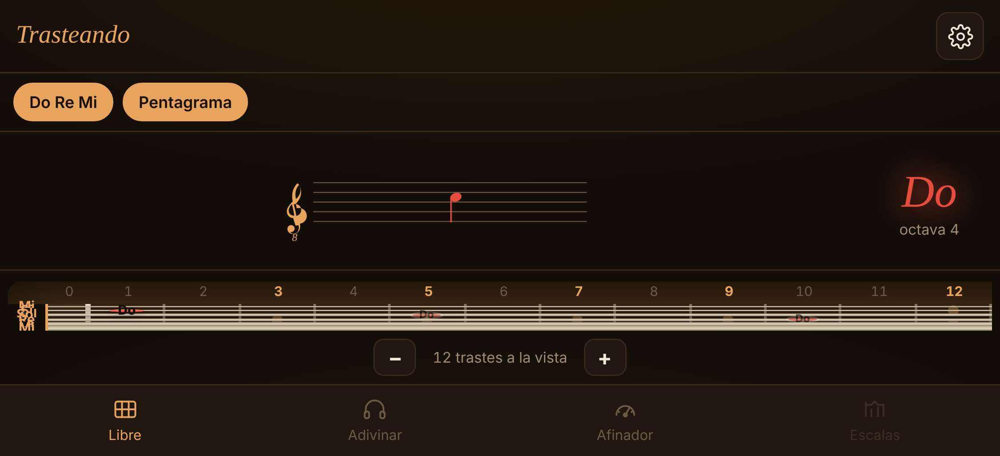
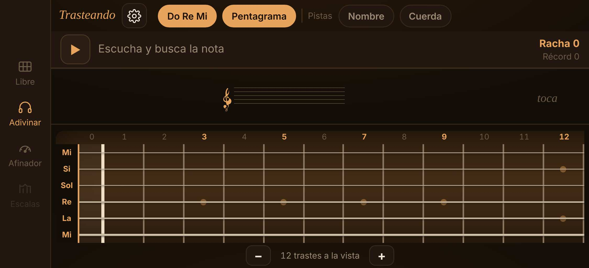

# V-01 — Lista de F1.1 en navegador real

**Fecha:** 15/10/2026 · **App:** `0.1.4` (y `0.1.2` para comparar el audio) · **Quién:** agente, con `herramientas/comprobar-en-navegador.js`
**Entorno:** Chromium 1194 con Playwright, servido como Live Server. Escritorio a 1280×800 y 420×800; iPhone 13 y iPhone SE emulados en vertical y apaisado.
**Diferencias con tu entorno:** el entorno del agente no llega a cdnjs ni a nbrosowsky.github.io, así que se sirven copias locales. Las muestras son idénticas (misma sha256). Tone.js es la 15.1.22 de su web oficial, no la 14.8.49; la elección y el transporte de muestras (`_findClosest`, `playbackRate`) son iguales en las dos.

## Resultado

| # | Comprobación | Resultado | Dato |
|:---:|---|:---:|---|
| 1 | Al abrir Afinador, el mástil desaparece | ✅ | — |
| 2 | La nota suena al instante | ✅ | 0,5 ms de la pulsación a la orden; programada sin adelanto |
| 3 | 1ª cuerda, trastes 12 y 24 en el pentagrama, 8va en el 24 | ✅ | — |
| 4 | 6ª cuerda al mínimo: 8vb | ✅ | baja hasta La1 |
| 5 | Acústica y Restablecer: vuelve la clásica | ✅ | El panel se cierra al restablecer |
| 6 | Cambiar a C D E pasados 3 s | ✅ | Mi → E |
| 7 | Zoom sobre el traste 15 conserva la vista | ✅ | centro 14,99 → 14,99 |
| 8 | Ventana estrecha: la etiqueta dice los trastes que caben | ✅ | «10 trastes»; caben 10,18 |
| 9 | Fallo en Adivinar: marca, revela y suena la buscada | ✅ | 5 de 5 posiciones iluminadas |
| 10 | «Ver todas»: en Libre sí, en Adivinar no | ✅ | 150 nombres en Libre, 0 en Adivinar |
| 11 | Numeración en Guía | ✅ | 3, 5, 7, 9, 12, 15, 17, 19, 21, 24 |
| 12 | Versión en Ajustes | ✅ | Trasteando 0.1.4 |
| 13 | Récord y ajustes tras recargar | ✅ | — |
| 14 | Recorrido sin errores en la consola | ✅ | ninguno |
| 15 | Clásica, 1ª cuerda, trastes 7, 8 y 12 afinados | ✅ | ver abajo |
| — | Móvil en vertical | ✅ | 51 px por cuerda, 9 trastes como máximo |
| — | **Móvil apaisado** | ❌ | **3 px por cuerda** en iPhone 13, **0 px** en iPhone SE |

## El sonido, medido en la salida del navegador

Grabado lo que sale por el audio de Chromium y medido con `herramientas/medir-afinacion.py`:

| Nota | Esperada | 0.1.2 | 0.1.4 |
|---|---:|---:|---:|
| Si4, traste 7 | 493,88 Hz | 493,66 Hz (−0,8 cents) | 493,66 Hz (−0,8 cents) |
| Do5, traste 8 | 523,25 Hz | **554,69 Hz (+101 cents, suena Do♯5)** | 522,94 Hz (−1,0 cents) |
| Mi5, traste 12 | 659,26 Hz | **698,81 Hz (+101 cents, suena Fa5)** | 658,32 Hz (−2,4 cents) |

Confirma de principio a fin el error de la 0.1.2 y la corrección de la 0.1.3.

## Hallazgo: el mástil desaparece con el móvil en horizontal

Alturas medidas en el iPhone 13 apaisado (342 px útiles): cabecera 55, atajos 44, pentagrama 104, pestañas 54. Al mástil le quedan 85 px, de los que la fila de números y el zoom se llevan casi todo: 3 px por cuerda. En el iPhone SE no queda nada. La regla `@media (max-height:520px)` de la 0.1.1 (AUD-04) reduce el pentagrama, pero no basta.

Contradice V-01, que sugiere girar el móvil a horizontal. La solución de fondo es el diseño apaisado de F3.2.

**Arreglo provisional en la 0.1.5**, aprobado por el cliente el 15/10: en pantallas bajas y apaisadas, las pestañas pasan a una columna a la izquierda, la cabecera comparte fila con los atajos y el pentagrama encoge.

| Dispositivo apaisado | Libre | Adivinar |
|---|---:|---:|
| iPhone 13 | 3 → **29 px** | → **21 px** |
| iPhone SE | 0 → **25 px** | → **17 px** |
| Pixel 7 | **32 px** | **24 px** |
| iPad Mini | **68 px** | **59 px** |

## Lo que sigue necesitando tu dispositivo

Safari de verdad (el iPhone emulado usa el motor de Chrome), el altavoz y el interruptor de silencio del iPhone, el tacto, y el sonido percibido. Todo eso va a la Sesión 1.
